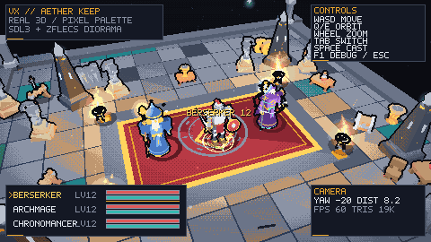
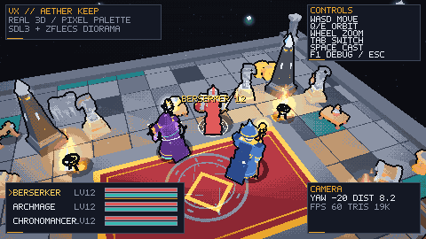
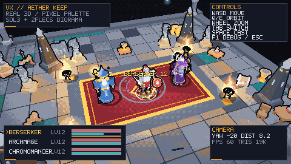

# VX / Aether Keep

**真 3D 模型 + 像素画风渲染 + 固定俯视可旋转第三人称**

基于 Zig 0.17、SDL3 与 zflecs 的可运行垂直切片（vertical slice）。场景里的角色、道具和环境都是**真实 3D 网格**（OBJ → 自带 VXM 模型格式），经过低分辨率软件光栅化、受限调色板量化、Bayer 抖动和深度描边，最终以像素画质感呈现。



> 本分支为 `feat/pixel3d-arena`，工作树位于 `D:\code\zig\vx-pixel3d`。
> 分支创建时的基线是 `0539afb`（zflecs demo）；主分支 `main` 保留给数值与具体内容设计，本分支没有向 main 提交任何内容。
> main 之后若出现其他提交（例如 .gitignore 调整），属于独立工作，不属于本分支。
> 确认设计后可以手动合并：`git -C D:\code\zig\vx merge feat/pixel3d-arena`。

---

## 现在能跑什么

- **真 3D 渲染**：带骨骼的 OBJ 角色、Kenney CC0 低模场景道具，透视投影 + 近平面裁剪 + z-buffer + 平面光照 + 点光源 + 雾。
- **像素画风**：480×270 内部渲染，整数倍最近邻放大（默认 3× = 1440×810），64 色调色板、4×4 Bayer 抖动、按物体 ID/深度差生成的深色描边。
- **固定俯视角可旋转第三人称**：相机围绕当前英雄旋转（yaw），俯仰角固定，距离可缩放；相机平滑跟随当前英雄。
- **三个 ToME4 风格职业**：狂战士 / 元素法师 / 时空法师，各自有独立低模、配色、武器、浮游物件和动画姿态。
- **zflecs ECS**：移动、编队跟随、动画姿态、能量回复、浮游物旋转都是 ECS system；场景道具、灯光、粒子也都是实体或 ECS 数据。
- **SDL3 窗口**：窗口/输入/计时/整数缩放展示；渲染本身是自写软件光栅器，便于无窗口验证。
- **无窗口截图**：`--headless` 可在没有桌面/CI 环境生成 PNG，方便验证和生成文档图。
- **可复现资源管线**：Python 脚本从 OBJ 生成角色、烘焙逐三角形颜色和骨架，输出紧凑的 VXM 二进制并内嵌进可执行文件。


*左：狂战士（板甲、红披风、圆盾、双手大剑）；中：元素法师（尖帽、白须、元素法杖与浮游碎片）；右：时空法师（兜帽、齿轮肩甲、沙漏法杖、时空光环）。*

---

## 快速开始

### 环境

- Zig **0.17.0**（项目按该版本开发；`zig version` 验证）
- Windows / macOS / Linux（SDL3 由依赖从源码构建；本次在 Windows 11 + Zig 0.17.0 实测）
- 首次构建会编译 SDL3 与 flecs，耗时几分钟；后续增量构建很快
- 生成资源需要 Python 3 + Pillow；**运行游戏不需要 Python**（VXM 已提交并内嵌）

### 构建与运行

```powershell
# 开发运行（默认 ReleaseFast，软件光栅化下约 58-60 FPS）
zig build run

# 无窗口截图（默认 480x270）
zig build run -- --headless --frames 1 --out docs/screenshots/gameplay.png

# 类展示相机（文档/预览用）
zig build run -- --headless --frames 2 --lineup --hide-hud --out docs/screenshots/lineup.png

# 窗口模式跑 2 秒、截图并退出（用于冒烟测试）
zig build run -- --run-seconds 2 --out docs/screenshots/window.png

# Debug 构建（调试器友好，帧率会低很多）
zig build -Doptimize=debug

# 单元测试 + 无窗口集成测试
zig build test
```

如果直接运行构建产物：

```powershell
.\zig-out\bin\vx.exe --headless --frames 1 --out docs\screenshots\gameplay.png
```

### 常用参数

| 参数 | 说明 |
| --- | --- |
| `--headless` | 不创建窗口，渲染到 PNG |
| `--out PATH` | 输出 PNG 路径，默认 `shots/vx.png` |
| `--frames N` | 无窗口模式：截图前模拟 N 帧（默认 1；窗口模式则自动退出） |
| `--run-seconds S` | 窗口模式：运行 S 秒后截图退出 |
| `--hero N` | 初始英雄：0 狂战士 / 1 元素法师 / 2 时空法师 |
| `--yaw DEG` | 相机水平角（度），默认 -20° |
| `--pitch DEG` | 相机俯仰角（度），默认约 40° |
| `--dist U` | 相机距离，默认 8.2 |
| `--res WxH` | 内部像素分辨率，默认 480×270 |
| `--scale N` | 窗口整数放大倍数，默认 3 |
| `--walk` | 无窗口模式：持续按 W，验证行走/跟随 |
| `--cast` | 无窗口模式：最后一帧释放一次技能 |
| `--lineup` | 角色展示相机（非游戏视角，仅文档/检查用） |
| `--hide-hud` | 不绘制 HUD |
| `--debug` | 显示调试行（三角数、绘制像素、帧耗时等） |

---

## 操作

| 输入 | 行为 |
| --- | --- |
| `W A S D` | 相对相机方向移动当前英雄 |
| `Q / E`、方向键左右、鼠标右键拖拽 | 旋转相机（yaw） |
| 鼠标滚轮 | 缩放相机距离 |
| `TAB` | 切换当前控制的英雄（其余两人自动编队跟随） |
| `SPACE` | 释放一次技能（消耗 35 AP，触发施法姿态和粒子；AP 自动回复） |
| `R` | 重置队伍站位 |
| `F1` | 调试 HUD |
| `F12` | 保存 `shots/capture-<frame>.png` |
| `ESC` | 退出 |


*相机绕当前英雄旋转；同一套真实 3D 场景在任意 yaw 下都保持正确的遮挡、光照和描边。*

---

## 项目结构

```text
build.zig                  Zig 构建（SDL3 + zflecs + assets 模块）
build.zig.zon              依赖版本锁定（SDL 3.4.18 / zflecs 4.1.5）
src/
  main.zig                  CLI、SDL 窗口主循环、无窗口截图
  root.zig                  模块导出 + 集成测试
  core/
    math.zig               Vec2/3/4、Mat4、OrbitCamera
    color.zig              sRGB/线性、打包颜色、哈希
    palette.zig            64 色调色板、量化缓存、Bayer 抖动
    font.zig               5×7 像素字体
    png.zig                无依赖 PNG 编码器
  engine/
    model.zig              VXM 加载、关节/部件/三角形颜色
    rig.zig                程序化姿态（呼吸、行走、施法、浮游物旋转）
    arena_mesh.zig         程序化竞技场：浮空岛、地砖、地毯、石基
    renderer.zig           软件光栅器、光照、雾、调色板、描边、HUD 图元
  game/
    components.zig         ECS 组件
    systems.zig            Formation/Movement/Animation/Gauges/Motes/Spin
    hud.zig                HUD 与投影姓名牌
    game.zig               世界搭建、输入、相机、灯光、粒子、渲染流程
  platform/
    sdl.zig                SDL3 窗口/输入/计时/纹理展示
assets/
  models/*.obj|.mtl|.json  程序化角色源模型 + 骨架说明
  kenney/                  Kenney CC0 原始 OBJ/MTL/colormap
  baked/*.vxm              烘焙后的运行时模型（内嵌）
  assets.zig               自动生成的 `@embedFile` 清单
tools/
  geometry.py              低模几何工具（盒/锥台/球/环/棱柱）
  characters.py            三个职业的程序化建模与 OBJ/JSON 导出
  bake_assets.py           OBJ+MTL+贴图 → VXM、Kenney 道具、额外道具、清单
docs/
  screenshots/             README/验证用截图
```

---

## 渲染管线

1. **模型**：`tools/characters.py` 以关节分组生成 OBJ（每个关节一个 `o` 组），`bake_assets.py` 把顶点转换到关节局部空间、逐三角形采样颜色（Kenney colormap 或 MTL），写出 VXM。
2. **ECS 姿态**：`VX.Animation` system 每帧计算各关节的局部/世界矩阵，写入 `Pose` 组件；角色、武器、披风、沙漏、光环分别跟随骨骼。
3. **骨骼蒙皮（刚性部件）**：每个部件是绑定到单关节的刚性网格，绘制时用 `entity × joint` 变换；低模像素风不需要线性混合蒙皮。
4. **视图/裁剪/投影**：右手系、Y 向上，视图空间近平面 `z <= -near` 做 Sutherland–Hodgman 裁剪。
5. **光栅化**：屏幕空间边函数 + 1/w 深度插值 + z-buffer；背面剔除。
6. **光照**：逐三角形平面着色 —— 环境光、冷色月光、暖色 key light、相机边缘光、最多 18 个点光源（火盆/法杖/沙漏/晶塔/英雄补光）和距离雾。
7. **像素化**：480×270 颜色缓冲 → 64 色最近邻量化（带 Bayer 抖动）→ 深度/ID 轮廓 → 5×7 HUD/姓名牌。
8. **展示**：SDL 以 `SDL_LOGICAL_PRESENTATION_INTEGER_SCALE` 最近邻放大到窗口，黑边保持整数像素。



---

## ECS 结构（zflecs）

| 组件 | 用途 |
| --- | --- |
| `Transform` / `Velocity` / `MoveIntent` | 位置、速度、移动意图 |
| `Hero` | 职业、等级、HP/AP、移速、当前操控标记 |
| `Follow` | 队友编队目标（相对 leader 的 offset） |
| `Animation` / `Pose` | 动画状态与每帧关节矩阵 |
| `Renderable` | 模型索引、tint、加色标记、描边 ID |
| `LightSource` / `Shadow` | 点光源参数、贴地阴影半径 |
| `Mote` / `Spin` | 环绕英雄的浮游物、旋转装饰 |

| System | 作用 |
| --- | --- |
| `VX.Formation` | 计算队友的目标位置并转成移动意图 |
| `VX.Movement` | 加速/阻尼、积分、边界约束、朝向平滑、步态相位 |
| `VX.Animation` | 根据移速/施法/职业生成 `Pose` |
| `VX.Gauges` | AP 自动回复 |
| `VX.Motes` | 元素碎片/时间碎片绕英雄旋转 |
| `VX.Spins` | 场景浮游碎片缓慢自转 |

---

## 资源与模型

### 三个职业（ToME4 参考）

| 职业 | 参考 | 模型特征 |
| --- | --- | --- |
| **Berserker / 狂战士** | ToME4 战士系（Berserker/Bulwark） | 板甲、红缨盔、绯红披风、圆形盾、双手大剑；施法/挥砍时手臂与剑随骨骼摆动 |
| **Archmage / 元素法师** | ToME4 元素法师（Archmage） | 尖顶法师帽、藏青长袍、白胡须、木质法杖 + 发光元素宝珠；火/冰/雷三枚碎片绕身 |
| **Chronomancer / 时空法师** | ToME4 时空系（Paradox Mage / Temporal Warden） | 兜帽紫袍、黄铜齿轮肩甲、发光青眼、沙漏法杖、旋转时间环与浮空符文 |

三人都：
- 由 OBJ 网格组成（可导出到任意 3D 工具检查）；
- 带关节层级（root/hips/torso/head/arms/legs/cape/weapon/offhand/focus/aura）；
- 内置程序化 idle、行走、施法姿态和浮游物动画。

### Kenney 场景道具

从 [Kenney 3D](https://kenney.nl/assets/category:3D) 的 **Mini Dungeon** 与 **Mini Arena** 免费 CC0 包中选取：木桶、箱子、柱子、雕像、桌椅、药水、武器架、金币、树木、砖块、旗帜、门拱等；颜色从原包 colormap 纹理逐面采样，烘焙为平面色。



*施法：消耗 AP，抬起法杖/剑，迸出粒子；HUD 的 AP 条同步下降。*

### 重新生成资源

```powershell
# 需要 Python 3 与 Pillow（pip install pillow）
python tools/characters.py     # 生成 assets/models/*.obj|.mtl|.rig.json
python tools/bake_assets.py    # 生成 assets/baked/*.vxm 与 assets/assets.zig
zig build                      # 重新内嵌资源
```

VXM 是自定义紧凑格式：文件头、模型名、AABB、关节表（名字/父索引/rest offset）、部件表（关节、顶点、索引、逐三角形颜色 + emissive 标记）。详见 `docs/ARCHITECTURE.md` 与 `tools/bake_assets.py` 顶部注释。

> 本次**没有**依赖 Blender/MCP：角色由 `tools/characters.py` 程序化构建为真实 OBJ 网格。如果后续想精修造型，可以继续在 Blender 中编辑这些 OBJ（保持 `o <joint>` 分组），再走同一条烘焙管线。

---

## 测试与验证

```powershell
zig build test
```

包含：
- 数学/相机/调色板/字体/PNG 编码单元测试；
- 所有内嵌 VXM 模型加载测试（关节、部件、特殊关节存在性）；
- 无窗口集成测试：创建 ECS 世界、模拟 12 帧、渲染一帧，检查三角数与绘制像素数。

无窗口截图本身也是验证手段：`docs/screenshots/*.png` 都由 `--headless` 生成，便于在 CI 或远程会话中检查渲染结果。窗口模式则用 `--run-seconds` 截图冒烟验证。

---

## 已知限制 / 下一步

- **数值与内容留给主分支设计**：技能树、命中/伤害/AP 公式、敌人、掉落、地图生成等尚未实现；当前 AP/HP/等级是占位数值，HUD 展示用。
- **战斗**：只有施法表现，没有目标选择、伤害结算或敌人 AI。
- **模型**：程序化低模偏“玩具感”；可在 Blender 中细化后替换 OBJ，烘焙流程不变。
- **音频/存档/手柄**：未实现。
- **相机**：俯仰角固定（设计目标）；如需自由俯仰，可在 `OrbitCamera.pitch` 与输入中放开。
- **性能**：480×270 ReleaseFast 约 58-60 FPS；若提高内部分辨率或增加光源，需要再做裁剪/合批优化。

---

## 许可与致谢

- **Kenney**：Mini Dungeon / Mini Arena，CC0 1.0，https://kenney.nl/assets/mini-dungeon 与 https://kenney.nl/assets/mini-arena。原始 OBJ/贴图与许可证见 `assets/kenney/`，完整版权/许可见 `assets/CREDITS.md`。
- **SDL3**：通过 castholm/SDL Zig 包构建（zlib 许可）。
- **flecs / zflecs**：MIT。
- **VX 的角色模型、程序化道具、代码**：为本项目生成/编写。

---

*Built with Zig 0.17 + SDL3 + zflecs. Real meshes, chunky pixels.*