# VX / 以太堡：深层

**单英雄回合制 Roguelike + 真 3D 模型 + 像素画风 + 固定俯视可旋转相机**

选一个职业，在 31×31 的 3D 像素地牢里一格一格推进；相机跟随主角，屏幕只显示地图局部。玩家行动一次，敌人按速度行动；用天赋、装备、等级和地形击败楼层守卫。画面保留真实 3D 网格、640×360 软件光栅化、64 色量化和 Bayer 抖动，玩法围绕回合制、格子、职业/天赋、掉落/装备和楼层推进。

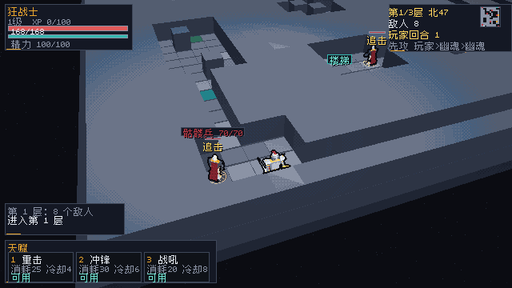

## 现在能跑什么

- **回合制**：玩家移动/普攻/天赋/等待后，敌人按速度依次行动；冷却、资源、状态按回合结算，不按秒。
- **单角色 + 3 职业**：狂战士（精力）、元素法师（法力）、时空法师（悖论），每职业 3 个天赋。
- **开局职业菜单**：窗口启动先看三张职业卡（资源、生命、定位、3 个天赋及一行效果）；按 1/2/3 选职业并进入该 seed 的地牢；默认每局随机种子，`--seed N` 可锁固定种子。`--hero` 直接开局，headless 默认跳过菜单。
- **格子与地牢**：31×31 网格，大于屏幕；相机跟随主角并在地图边缘夹取；墙/柱子/水域阻挡；撞墙不消耗回合，撞敌人 = 普攻；3 层，楼梯下一层，第 3 层 Boss；Boss 存活时楼梯被封印；Boss 免疫眩晕，但减速和灼烧仍有效；Boss 血量降到 50% 召唤 1 只骷髅（半血、入场眩晕 1 回合），低于 35% 进入狂暴，攻击 +15%、速度 +10，头顶显示 RAGE。
- **确定性关卡**：同一 seed 生成同一层（显式 `--seed` 时完全可复现）；入口、楼梯、宝箱、陷阱、敌人出生点由连通性校验；敌人用 A* 绕墙追击，远程用 LOS。
- **升级加点**：升级获得 1 点，C 面板按 1-6 加力量/敏捷/体质/感知/魔力/意志；自动跑局自动加主属性。
- **瞄准范围反馈**：进入瞄准后，每个敌人头顶显示绿色 OK / 红色 OUT，脚下地环同色；选中目标名字也按可打/超范围变色。
- **快速设置**：F2 打开全屏/垂直同步/窗口倍率；1/2/3 调整，Esc 关闭；写入 saves/settings.json，下次启动生效。旧 saves/ 首次启动自动迁移到用户目录。
- **手柄/Steam Input**：D-pad/左摇杆移动，A/B/X/Y 确认/取消/背包/角色，肩键天赋；SDL3 Gamepad 基础映射，支持热插拔。
- **程序化音频**：步进/命中/施法/拾取/死亡/UI + 低频环境音 + 按探索/危险/商店/死亡/胜利切换的五声音阶 motif，SDL3 audio stream 生成，无外部音频；F2 调音量/环境音并持久化。
- **Kenney HUD 图标**：背包/角色/金币/药水/设置等 12×12 单色图标，标题栏 2×；来源 CC0，见 [docs/UI_ICONS.md](docs/UI_ICONS.md)。
- **装备对比**：背包内每件可装备物品右侧显示相对当前槽位的战力差（+/-/NEW），空槽显示 NEW；已装备三槽常驻底部。
- **属性/装备/掉落**：六属性、HP/资源、攻击/护甲/暴击/速度；13 件装备/道具，宝箱和击杀产生掉落，空槽自动装备，装备即时改变面板数值；生命瓶/魔力瓶可按 P 直接使用；背包底栏显示剩余数量，底部常驻显示主手/身体/饰品三槽。
- **天赋瞄准**：1/2/3 先进入瞄准，显示目标/距离/预计伤害/范围；空格/同键/左键确认，Esc 取消，Tab 换目标；火球可点地面格，AOE 范围环实时预览，命中附加 2 回合灼烧；超距/无视线/缺资源红色提示。
- **敌人阶段/先攻**：玩家行动后 HUD 显示“敌人行动”，锁定输入约 0.3 秒再结算敌人移动/攻击；顶栏同时显示“先攻 玩家>两名最快敌人”，与敌人阶段的速度排序一致；敌人头顶显示攻击/远程/追击/深渊斩意图。自动跑局和 QA 仍即时结算。
- **三槽存档 + 自动档**：F5/F9 打开槽位面板，1/2/3 保存或读取；每槽一个 JSON 容器（run+gear 一次原子提交）。下到新楼层自动轮换 saves/autosave1..3.save，F10 打开自动档面板读取最近 3 个备份。
- **存档/读档**：槽1/2/3 分别写用户目录 saves/slot1.save / slot2.save / slot3.save，一个文件同时装 Sim 全状态、背包/装备与 loot_rng；F9 槽位面板读取；坏档不覆盖当前局。旧 run/gear 双文件仍可回退读取。
- **中文 HUD（常驻面板 <30%）**：角色卡、楼层卡、战斗日志、天赋栏、角色/背包面板；背包显示品质/属性摘要，天赋栏显示消耗、基础冷却和当前状态（可用/冷却中/缺资源），角色面板可复查。H 打开操作说明；首次选职业会弹一次 8 秒操作提示。Ark Pixel 12px 子集。
- **3D 像素场景**：地牢地砖、墙、楼梯、宝箱、陷阱、精英和 Boss 模型；脚底环、目标血条、危险标记、楼梯光柱。
- **难度**：开局菜单 D 在 NORMAL → HARD → EASY 循环；困难敌人 HP ×1.15/伤害 ×1.08，简单 HP ×0.80/伤害 ×0.90，难度随存档保存。
- **时空反噬**：时间停止命中免疫眩晕的 Boss 时，改为减速 2 回合并追加 0.5× 攻击反噬。
- **7 种敌人**：新增深渊幽魂，远程攻击附带 2 回合灼烧；第 2/3 层生成。
- **破绽 VULN**：战士冲锋给敌人 2 回合破绽（受伤 +20%）；石魔像命中给英雄 1 回合、Boss 深渊斩给 2 回合，双方都可能进入破绽。
- **楼层词条**：第 2/3 层随机 EMBER（灼烧 ×1.5）/ FROST（敌人速度 ×0.9）/ MIASMA（资源回复 ×0.5）/ GILDED（金币 ×1.5）/ BLOODMOON（XP ×1.5、伤害 ×1.1）/ SURGE（敌人速度 ×1.05、XP ×1.25），HUD 敌人行显示词条，随存档保存。
- **状态注册表**：status_def 统一 STUN/SLOW/BURN/VULN/GUARD 的 tag、中文名、颜色、是否 debuff 与灼烧最大层数；帮助面板可查状态图例。
- **灼烧叠层**：火球灼烧持续 5 回合，同一目标最多叠 3 层，每跳按 1/1.5/2 倍伤害；敌方对英雄的灼烧只刷新不叠层。
- **骷髅举盾**：骷髅/精英骷髅半血以下每 5 次行动举盾 1 回合，受伤减半，拖慢近战输出。
- **幽魂汲取**：幽魂/精英幽魂每 3 次行动汲取一次，0.7× 伤害并回复 50% 伤害，逼玩家打断或速杀。
- **石魔像震地**：距离 2 格且有视线时，每 3 次行动用一次 0.4× 远程震击（无破绽），逼玩家贴近或绕柱。
- **精英词缀**：第 2 层起约 27% 非 Boss 敌人带迅捷/重甲/吸血/爆裂/FROST（命中 SLOW 2 回合）/BRSK（半血以下伤害 +25%）；第 3 层另有 2% SPLIT（死亡生成 20% HP、眩晕 1 回合的回响）。头顶显示 SWIFT / ARM / VAMP / VOL / FROST / BRSK / SPLIT。
- **持久战绩**：saves/records.json 记录胜场/败场、三职业胜场、最佳楼层/回合/击杀/金币、累计 chunk 清空；开局菜单显示 BEST Fx Ty Kz Gw | WINS a/b/c CHn 与 BADGES（FIRST-WIN / ALL-CLASS / FLAWLESS / CHUNK HUNTER / DAILY DELVER / STREAK 3），达成时顶部弹 BADGE 提示，死亡/胜利后自动更新。
- **诅咒宝箱**：约 22% 宝箱为红色诅咒箱，开箱扣 10% 最大生命并附加 1 回合破绽，但给 25 金币；可看颜色绕开。
- **金币/补给站**：击杀与宝箱掉金币；每层一个 SHOP，可花 25G 治疗、60G 主属性 +2、60G 体质 +2、20G 净化（清除灼烧/减速/破绽）、80G 随机补给（按掉落表给一件装备/道具，自动装备更好者）、40G 补 1 枚 FIRE BOMB（英雄计数，不占背包），使用一次后消失。
- **祭坛**：每层一处；踩上去四选一：主属性 / 体质 / 意志 +2，或 RISK 主属性 +4、体质 -2；Esc 可离开，使用后消失；HUD 显示 SHRINE 面板。
- **无窗口验证**：headless 截图；自动跑局用于 QA。

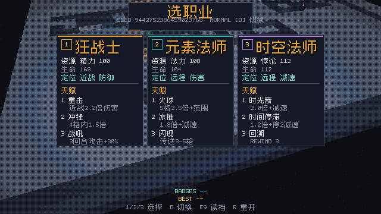

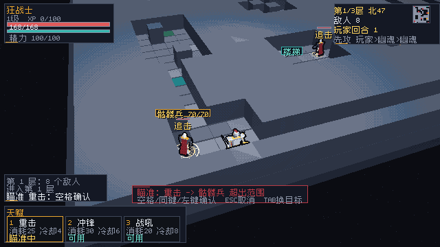

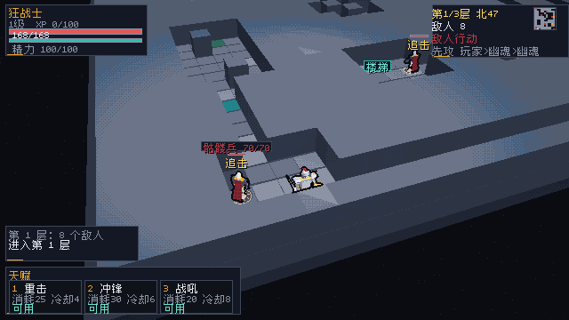

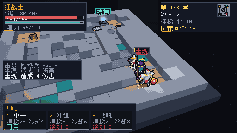

## 截图

| 商店 | 祭坛 |
| --- | --- |
| 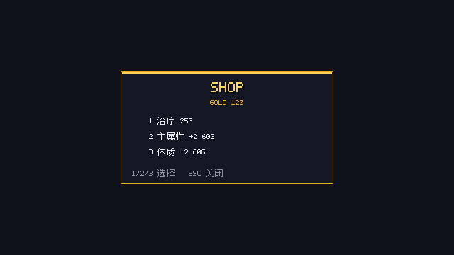 | 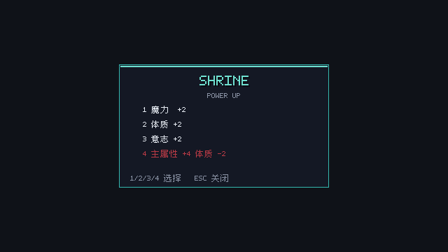 |

| 背包对比 | 帮助/状态 |
| --- | --- |
| 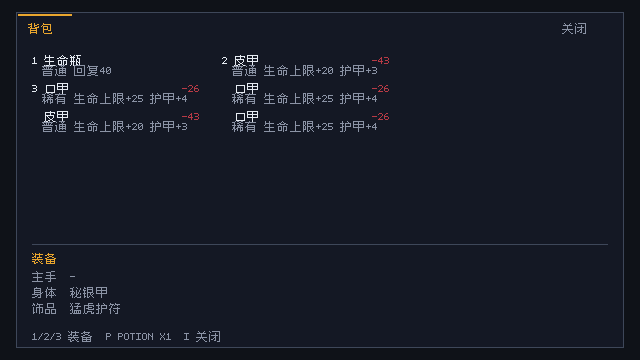 | 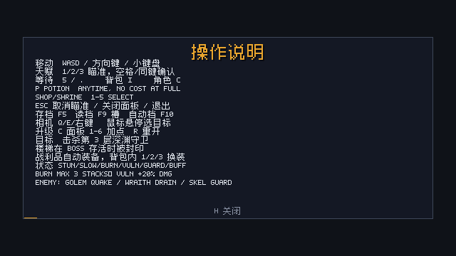 |

| 瞄准范围 | 设置 |
| --- | --- |
| 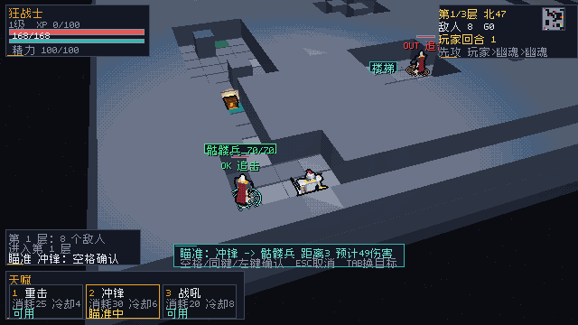 | 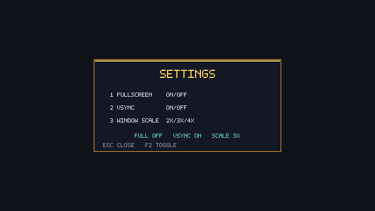 |

截图统一量化为 64 色；运行 python tools/shrink_shots.py --check docs/screenshots 检查体积。

## 快速开始

### 环境

- Zig **0.17.0**
- Windows / macOS / Linux；首次构建 SDL3 需要几分钟
- 运行不需要 Python / Blender；改资源/字体时才需要 Python 3 + Pillow

### 构建与运行

~~~powershell
zig build run                  # 默认回合制（先选职业）
zig build test                 # 单元 + 集成测试
zig build run -- --headless --start-menu --frames 2 --out shots/run-select.png
zig build run -- --headless --frames 2 --out shots/run.png
zig build run -- --headless --auto --frames 30000 --out shots/run-auto.png
zig build run -- --arena       # 旧版实时 5 波竞技场（保留作对照）
~~~

默认内部 **640×360**，窗口 3× 最近邻放大到 **1920×1080**；小屏可用 --scale 2。

### 操作

| 输入 | 行为 |
| --- | --- |
| WASD / 方向键 / 小键盘 | 走一格；撞敌人 = 普攻；撞墙不消耗回合；按住连续走 |
| 1 / 2 / 3 | 开局菜单：选择职业并开始；游戏中：进入天赋瞄准（战吼/闪现/回溯立即释放） |
| D | 开局菜单：切换普通/困难（游戏中 D 仍是向右走） |
| 空格 / 同键 | 瞄准中确认释放；非瞄准时等待一回合 |
| Esc | 取消瞄准 → 关闭面板 → 打开暂停 |
| Q/Start | 暂停菜单中按两次退出游戏（先落盘，暂停时音频淡出） |
| 5 / . | 等待一回合；附近无敌人时休息回复 |
| I | 背包；背包内按 1/2/3 装备前三件 |
| P | 任意时刻使用生命/魔力瓶（消耗一回合；满值不消耗） |
| 1 / 2 / 3 / 4 / 5 / 6 | SHOP/祭坛打开时：选择对应服务/祝福 |
| C | 角色面板（六属性、装备、天赋说明）；有升级点时按 1-6 加点 |
| Q/E、右键拖拽 | 旋转相机；滚轮缩放 |
| Tab | 瞄准中切换目标 |
| 鼠标 | 职业卡悬停/单击；暂停点 RESUME/HELP/SETTINGS/QUIT；商店/祭坛点行购买；角色面板点属性加点；背包点物品装备/药水饮用/炸弹投掷；战斗悬停高亮/选择目标；瞄准中左键确认 |
| R | 游戏中第一次按进入确认（2 秒内再按）；死亡/胜利立即重开；保留职业，默认换新种子；`--seed` 时保持 seed |
| F5 / F9 | 打开存档 / 读档槽位面板；1/2/3 选择，Esc 取消 |
| F10 | 打开自动档面板；1/2/3 读取最近 3 个楼层备份 |
| H | 打开/关闭操作说明（可在 F2 REMAP 中改） |
| M | 3×3 chunks 开启时：打开/关闭九宫格地图 |
| F2 | 快速设置：1 全屏 / 2 垂直同步 / 3 窗口倍率 / 4 音量 / 5 环境音 / 6 手柄 A/B 交换 / 7 WASD/ESDF / 8 REMAP KEYS / 9 CHUNKS 3x3 / 0 SCREEN SHAKE；键位细节见 [docs/KEYS.md](docs/KEYS.md) |
| F3 | 复制诊断并打开反馈表单（GitHub issue） |
| F4 | 复制诊断（版本/种子/职业/层数/回合/HP/设置）到剪贴板 |
| F7 | 打开 BADGES 本地成就面板 |
| F6 | 开局菜单进入每日挑战（UTC 种子） |
| F8 | 开局菜单重掷预览种子 |
| F11 | 全屏切换（也支持 --fullscreen 启动） |
| F1 / F12 | 调试 / 截图 |
| 手柄 D-pad/左摇杆 | 移动 |
| 右摇杆 / LT/RT | 转镜头 / 缩放 |
| 右摇杆按下 | 3×3 地图（chunks 开启时） |
| 手柄 A/B/X/Y | 确认 / 取消 / 背包 / 角色 |
| LB / RB / 左摇杆按下 | 天赋 1 / 2 / 3 |
| Start / Back | 帮助 / 设置 |

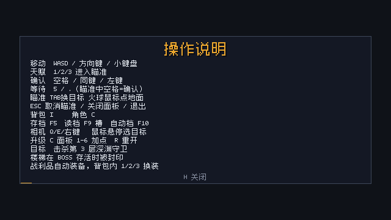

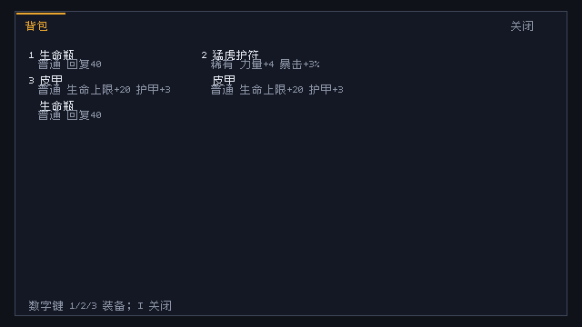

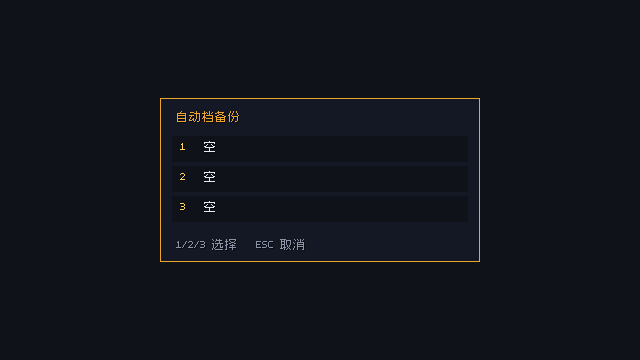

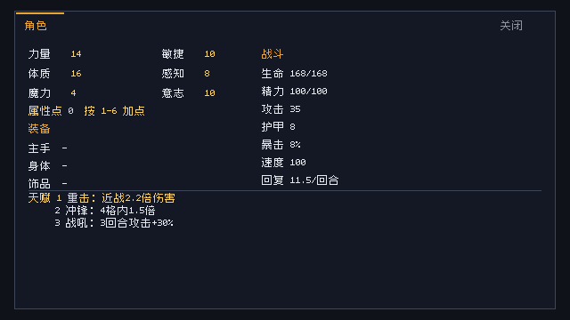

## 参数

| 参数 | 说明 |
| --- | --- |
| --headless | 不创建窗口，渲染 PNG |
| --out PATH | 截图路径 |
| --frames N | 模拟 N 帧后截图/退出 |
| --run-seconds S | 窗口运行 S 秒后截图退出 |
| --hero N | 0 狂战士 / 1 元素法师 / 2 时空法师；直接开局并跳过职业菜单 |
| --start-menu | 强制显示职业菜单（headless 截图/QA 用；headless 默认跳过） |
| --seed N | 固定地牢种子（默认 0 = 每局随机） |
| --difficulty normal\|hard | 难度；困难敌人 HP ×1.15、伤害 ×1.08 |
| --shrine | headless 打开祭坛面板（截图/QA） |
| --shop | headless 打开补给站面板（截图/QA） |
| --portable | 存档留在当前目录（开发/CI；默认写用户目录） |
| --version | 打印版本 |
| --save-info | 打印实际存档/设置/records 路径后退出 |
| --hide-labels | 隐藏世界内名字/意图（商店干净截图） |
| --chunks | 实验性 3×3 边缘门（默认关闭；v3 存档含 9 Arena；minimap 金点=邻接） |
| --fullscreen | 全屏启动（F11 运行时切换） |
| --settings | headless 打开设置面板（截图/QA） |
| --auto | headless 自动向楼梯推进、打怪、放天赋 |
| --inventory / --character | 启动时打开对应面板（截图/审查用） |
| --loot N | 调试：直接获得 N 件掉落（截图/QA 用） |
| --res WxH / --scale N | 分辨率 / 窗口倍率 |
| --arena | 切回旧版实时竞技场 |

## 玩法细节

### 回合与速度

- 玩家每轮先行动一次。
- 敌人按 speed 排序；每回合积累 energy，100 点行动一次，上限 200（最多连续两次）。150 会逐渐积累出双动，70 会隔回合少动；不再用 turn % 2 特判。
- 冷却、资源回复、状态持续时间都按回合数结算。
- 移动/普攻/天赋/等待才消耗回合；非法移动不消耗。

### 天赋

| 职业 | 资源 | 1 | 2 | 3 |
| --- | --- | --- | --- | --- |
| 狂战士 | 精力 | 重击（近战 2.2×） | 冲锋（4 格内 1.5×） | 战吼（3 回合 +30% 攻击） |
| 元素法师 | 法力 | 火球（5 格内 2.35× + 1.5 格溅射 + 2 回合灼烧） | 冰锥（1.8× + 减速） | 闪现（3–5 格空地） |
| 时空法师 | 悖论 | 时光箭（2.0× + 减速） | 时间停滞（1.2× + 眩晕2 + 减速2） | 回溯（回到3步前 + 清 debuff + 8%治疗） |

天赋栏显示消耗、基础冷却和当前状态（可用/冷却中/缺资源），下方一行说明实际效果；角色面板里也能复查（[截图](docs/screenshots/run_talent_panel.png)）。

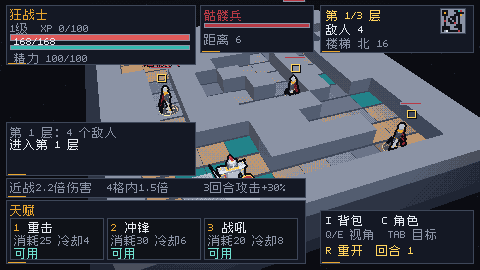

### 地牢与成长

- 3 层；每层入口随机在底/左/右，楼梯在对侧，保证连通。
- 宝箱 2–4 个、陷阱 1–4 个、敌人 8/9/6 个，随层数变化。
- 击杀获得 XP；升级 +1 主属性并回满；第 3 层击败深渊守卫、解除楼梯封印后胜利。
- 死亡即结束，R 默认用新种子重开并保留当前职业；显式 `--seed N` 时才保持同一张图。

数值/组件设计见 [docs/NUMERIC_ARCHITECTURE.md](docs/NUMERIC_ARCHITECTURE.md)；mech 数值层评估见 [docs/NUMERIC_MECH.md](docs/NUMERIC_MECH.md)；机制边界与 ECS 映射见 [docs/MECHANISMS.md](docs/MECHANISMS.md)；定义/组件/聚合审计见 [docs/DATA_MODEL.md](docs/DATA_MODEL.md)；FlecsScript 内容层评估见 [docs/FLECS_CONTENT.md](docs/FLECS_CONTENT.md)；像素化管线与分辨率取舍见 [docs/RENDERING.md](docs/RENDERING.md)。

## 代码结构

~~~text
src/
  core/        math / color / palette / png / font / cjk_font
  engine/      model / rig / arena_mesh / renderer
  game/
    run_sim.zig     纯回合制模拟（无 SDL/渲染）
    combat.zig      伤害类型/防御/暴击唯一管线
    run_game.zig    3D 场景、输入、相机、动画
    run_hud.zig     角色/楼层/目标/日志/天赋/面板
    dungeon.zig      31×31 确定性关卡、连通性、A*、LOS
    save.zig         RunState 存档/读档（纯逻辑，JSON v2）
    attributes.zig   六属性/派生/XP
    items.zig        装备/背包/修正
    content.zig      内嵌 JSON 内容加载/校验/掉落
    turn.zig         回合顺序核心（供后续多 actor 扩展）
    game.zig         旧版实时竞技场（--arena）
  platform/sdl.zig
assets/
  data/         items/enemies/skills JSON + data.zig
  baked/        VXM 运行时模型
  models/       OBJ/MTL/rig 源
tools/          characters / bake_assets / gen_cjk_font
docs/           RUN_V1 / SAVE / ART_PASS / UX_REVIEW_RUN / screenshots
~~~

## 验证

- zig build / zig build test：14/14 steps、266/266 tests。
- 一条命令发版自检：tools/preflight.ps1（fmt/三层测试/打包/Steam/Demo/Deck 静态/i18n/截图）；Python 可设 VX_PYTHON。
- headless：可生成职业菜单/开始/战斗/角色/背包/胜利截图；`--start-menu` 输出 `docs/screenshots/run_select.png`。
- 职业菜单显示的 SEED 就是本局真实 seed；选择职业只按同一 seed 重开；R 保留职业，未锁定时换新 seed。
- 大图 QA（100 seed × 3 职业，纯逻辑 bot）：普通 65.0%（195/300）：狂战士 53%、元素法师 79%、时空法师 63%；困难 37.7%（113/300）；简单 89.0%（267/300），0 超时/不变量违规；test-qa 145/145、test-qa3 250/250。
- auto 是演示/巡检 bot，不保证通关；31×31 + 楼层 Boss 下可能停在 Boss 层，实际 QA 以 test-qa 为准。
- Boss 深渊斩每 3 个敌方回合预警一次，半径 0.9 格；走出标记格即可躲开；Boss 存活时第 3 层楼梯封印。
- 速度机制已改为 energy 银行：精英幽魂 150 积累双动，石魔像 70 隔回合少动。
- 天赋瞄准/确认、F5/F9 存档读档均有单元测试；存档格式见 [docs/SAVE.md](docs/SAVE.md)。
- 窗口模式：640×360、3× 最近邻、SDL 输入/截图正常。

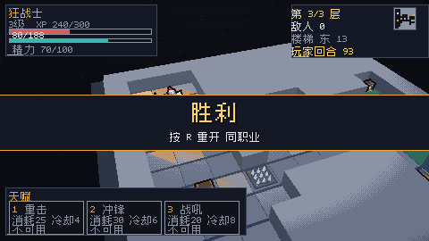

## 已知限制 / 下一步

- 天赋已支持 Tab 选目标、范围预览和 Esc 取消；更复杂的选格/多段目标待做。
- 背包内 1/2/3 可换装，空槽自动装备；多套装备/词缀/商店待做。
- 小怪主动技能已有骷髅举盾、幽魂汲取、石魔像震地；下一步是做更明显的预警/交互。
- 没有音频、天赋树、随机词缀；存档已接 F5/F9（见 [docs/SAVE.md](docs/SAVE.md)）。
- 当前数值是 v1 占位，优先验证循环与可读性。

## 发行计划

Steam 上架/商店素材/Demo/反馈闭环见 [docs/STEAM.md](docs/STEAM.md)；商店占位素材与生成器见 [docs/store/README.md](docs/store/README.md)；美术外包需求见 [docs/ART_BRIEF.md](docs/ART_BRIEF.md)；Auto-Cloud 配置见 [docs/STEAM_CLOUD.md](docs/STEAM_CLOUD.md)；启动/Deck 清单见 [docs/LAUNCH_CONFIG.md](docs/LAUNCH_CONFIG.md)、[docs/DECK_CHECK.md](docs/DECK_CHECK.md)；发行节奏见 [docs/RELEASE_PLAN.md](docs/RELEASE_PLAN.md)；就绪度见 [docs/RELEASE_READINESS.md](docs/RELEASE_READINESS.md)；SteamPipe 模板在 [steam/](steam/README.md)，后台清单见 [docs/STEAM_BACKEND.md](docs/STEAM_BACKEND.md)，变更记录见 [CHANGELOG.md](CHANGELOG.md)；当前任务/责任矩阵见 [docs/STATUS.md](docs/STATUS.md)；发版包复验见 [docs/BUILD_VERIFY.md](docs/BUILD_VERIFY.md)，发布签核见 [docs/RELEASE_SIGNOFF.md](docs/RELEASE_SIGNOFF.md)；玩家反馈流程见 [docs/FEEDBACK.md](docs/FEEDBACK.md)；商店页文案见 [docs/store/PAGE.md](docs/store/PAGE.md)；媒体包见 [docs/PRESS_KIT.md](docs/PRESS_KIT.md)（tools/press_kit.ps1）；测试流程见 [docs/PLAYTEST.md](docs/PLAYTEST.md)；测试包见 [docs/PLAYTEST_KIT.md](docs/PLAYTEST_KIT.md)；Demo 包见 [docs/DEMO.md](docs/DEMO.md)；招募见 [docs/RECRUIT.md](docs/RECRUIT.md)；预告片分镜见 [docs/TRAILER.md](docs/TRAILER.md)，30s 占位 MP4 见 [docs/store/TRAILER_MP4.md](docs/store/TRAILER_MP4.md)，29.5s 真实引擎内录屏见 [docs/store/GAMEPLAY_CAPTURE.md](docs/store/GAMEPLAY_CAPTURE.md)，30s capture 版预告片见 [docs/store/TRAILER_CAPTURE.md](docs/store/TRAILER_CAPTURE.md)；本地化审计见 [docs/LOCALIZATION_AUDIT.md](docs/LOCALIZATION_AUDIT.md)、实现状态 [docs/LOCALIZATION.md](docs/LOCALIZATION.md)、覆盖矩阵 [docs/I18N_COVERAGE.md](docs/I18N_COVERAGE.md)、残留审计 [docs/I18N_REMAINING.md](docs/I18N_REMAINING.md)（英文设置/菜单截图 settings_en.png / menu_en.png，内容仍未翻译）；按键重绑见 [docs/KEYS.md](docs/KEYS.md)；Steam Input 模板见 [docs/STEAM_INPUT.md](docs/STEAM_INPUT.md)。拆出的任务：#120 ECS Phase1、#121 Steam 构建、#122 商店/Demo/反馈、#123 设置/手柄。

## 致谢与许可

- **Kenney** Mini Dungeon / Mini Arena，CC0 1.0；见 assets/CREDITS.md。
- **Ark Pixel Font** by TakWolf，SIL OFL 1.1；见 assets/fonts/。
- **SDL3**（castholm/SDL Zig 包）、**flecs / zflecs**（MIT）。
- 角色、敌人、地牢道具和代码由本项目生成/编写。
- **玩法灵感**：ToME4（Tales of Maj'Eyal）的回合制、职业/天赋与地牢结构，仅作学习参考；本项目未包含其代码或素材。

---

*Built with Zig 0.17 + SDL3 + zflecs. Real meshes, chunky pixels, turn-based depths.*

- **受击反馈**：英雄掉血时红闪 + 轻量镜头震动；击败 Boss 时更强震动，快速衰减。
- **Boss 击败演出**：胜利后冻结 1.4s 显示 BOSS DEFEATED 横幅，确认键可跳过，再进入结算。
- **Boss 血条**：Boss 存活时顶部中央显示名字与血量。
