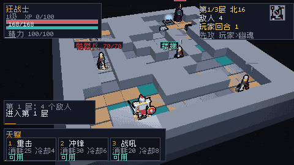
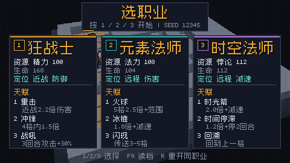
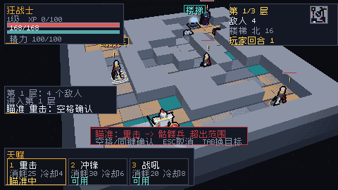
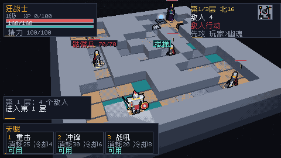
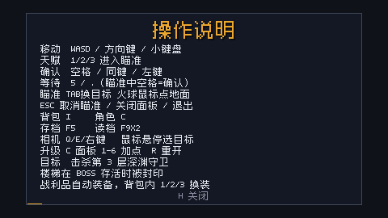
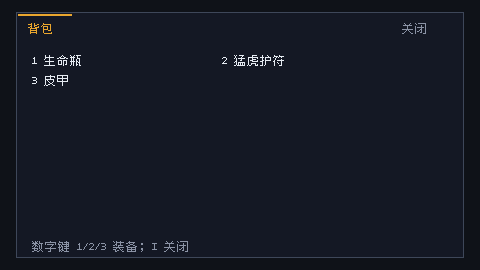
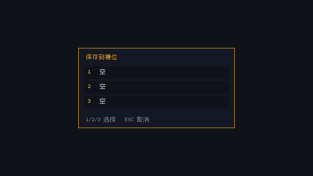
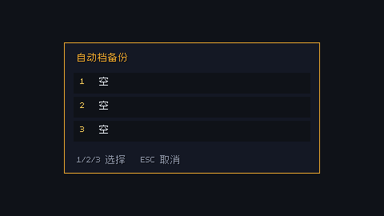
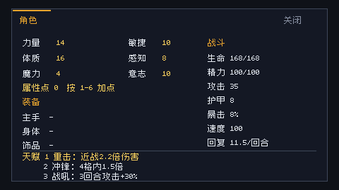

# VX / 以太堡：深层

**ToME4 风格回合制 Roguelike + 真 3D 模型 + 像素画风 + 固定俯视可旋转相机**

选一个职业，在 31×31 的 3D 像素地牢里一格一格推进；相机跟随主角，屏幕只显示地图局部。玩家行动一次，敌人行动一次；用天赋、装备、等级和地形击败楼层守卫。画面保留真实 3D 网格、640×360 软件光栅化、64 色量化和 Bayer 抖动；玩法转向 ToME4 的回合制、格子、职业/天赋、掉落/装备和楼层推进。

## 现在能跑什么

- **回合制**：玩家移动/普攻/天赋/等待后，敌人按速度依次行动；冷却、资源、状态按回合结算，不按秒。
- **单角色 + 3 职业**：狂战士（精力）、元素法师（法力）、时空法师（悖论），每职业 3 个天赋。
- **开局职业菜单**：窗口启动先看三张职业卡（资源、生命、定位、3 个天赋及一行效果）；按 1/2/3 选职业并进入该 seed 的地牢。`--hero` 直接开局，headless 默认跳过菜单。
- **格子与地牢**：31×31 网格，大于屏幕；相机跟随主角并在地图边缘夹取；墙/柱子/水域阻挡；撞墙不消耗回合，撞敌人 = 普攻；3 层，楼梯下一层，第 3 层 Boss；Boss 存活时楼梯被封印。
- **确定性关卡**：同一 seed 生成同一层；入口、楼梯、宝箱、陷阱、敌人出生点由连通性校验；敌人用 A* 绕墙追击，远程用 LOS。
- **升级加点**：升级获得 1 点，C 面板按 1-6 加力量/敏捷/体质/感知/魔力/意志；自动跑局自动加主属性。
- **属性/装备/掉落**：六属性、HP/资源、攻击/护甲/暴击/速度；宝箱和击杀产出版本内物品，空槽自动装备，装备即时改变面板数值。
- **天赋瞄准**：1/2/3 先进入瞄准，显示目标/距离/预计伤害/范围；空格/同键/左键确认，Esc 取消，Tab 换目标；火球可点地面格，AOE 范围环实时预览；超距/无视线/缺资源红色提示。
- **敌人阶段/先攻**：玩家行动后 HUD 显示“敌人行动”，锁定输入约 0.3 秒再结算敌人移动/攻击；顶栏同时显示“先攻 玩家>两名最快敌人”，与敌人阶段的速度排序一致；敌人头顶显示攻击/远程/追击/深渊斩意图。自动跑局和 QA 仍即时结算。
- **三槽存档 + 自动档**：F5/F9 打开槽位面板，1/2/3 保存或读取；每槽一个 JSON 容器（run+gear 一次原子提交）。下到新楼层自动轮换 saves/autosave1..3.save，F10 打开自动档面板读取最近 3 个备份。
- **存档/读档**：槽1/2/3 分别写 saves/tome-slot1.json / slot2.save / slot3.save，一个文件同时装 Sim 全状态、背包/装备与 loot_rng；F9 槽位面板读取；坏档不覆盖当前局。旧 tome-run/tome-gear 双文件仍可回退读取。
- **中文 HUD（常驻面板 <30%）**：角色卡、楼层卡、战斗日志、天赋栏、角色/背包面板；背包显示品质/属性摘要，天赋栏显示消耗、基础冷却和当前状态（可用/冷却中/缺资源），角色面板可复查。H 打开操作说明。Ark Pixel 12px 子集。
- **3D 像素场景**：地牢地砖、墙、楼梯、宝箱、陷阱、精英和 Boss 模型；脚底环、目标血条、危险标记、楼梯光柱。
- **无窗口验证**：headless 截图；自动跑局用于 QA。

## 快速开始

### 环境

- Zig **0.17.0**
- Windows / macOS / Linux；首次构建 SDL3 需要几分钟
- 运行不需要 Python / Blender；改资源/字体时才需要 Python 3 + Pillow

### 构建与运行

~~~powershell
zig build run                  # 默认 ToME 回合制（先选职业）
zig build test                 # 单元 + 集成测试
zig build run -- --headless --start-menu --frames 2 --out shots/tome-select.png
zig build run -- --headless --frames 2 --out shots/tome.png
zig build run -- --headless --auto --frames 30000 --out shots/tome-auto.png
zig build run -- --arena       # 旧版实时 5 波竞技场（保留作对照）
~~~

默认内部 **640×360**，窗口 3× 最近邻放大到 **1920×1080**；小屏可用 --scale 2。

### 操作

| 输入 | 行为 |
| --- | --- |
| WASD / 方向键 / 小键盘 | 走一格；撞敌人 = 普攻；撞墙不消耗回合；按住连续走 |
| 1 / 2 / 3 | 开局菜单：选择职业并开始；游戏中：进入天赋瞄准（战吼/闪现/回溯立即释放） |
| 空格 / 同键 | 瞄准中确认释放；非瞄准时等待一回合 |
| Esc | 取消瞄准 → 关闭面板 → 退出 |
| 5 / . | 等待一回合；附近无敌人时休息回复 |
| I | 背包；背包内按 1/2/3 装备前三件 |
| C | 角色面板（六属性、装备、天赋说明）；有升级点时按 1-6 加点 |
| Q/E、右键拖拽 | 旋转相机；滚轮缩放 |
| Tab | 瞄准中切换目标 |
| 鼠标 | 悬停高亮/选择目标；瞄准中左键确认 |
| R | 游戏中第一次按进入确认（2 秒内再按）；死亡/胜利立即重开；保留职业与 seed |
| F5 / F9 | 打开存档 / 读档槽位面板；1/2/3 选择，Esc 取消 |
| F10 | 打开自动档面板；1/2/3 读取最近 3 个楼层备份 |
| H | 打开/关闭操作说明 |
| F1 / F12 | 调试 / 截图 |

## 参数

| 参数 | 说明 |
| --- | --- |
| --headless | 不创建窗口，渲染 PNG |
| --out PATH | 截图路径 |
| --frames N | 模拟 N 帧后截图/退出 |
| --run-seconds S | 窗口运行 S 秒后截图退出 |
| --hero N | 0 狂战士 / 1 元素法师 / 2 时空法师；直接开局并跳过职业菜单 |
| --start-menu | 强制显示职业菜单（headless 截图/QA 用；headless 默认跳过） |
| --seed N | 地牢种子（默认 12345） |
| --auto | headless 自动向楼梯推进、打怪、放天赋 |
| --inventory / --character | 启动时打开对应面板（截图/审查用） |
| --loot N | 调试：直接获得 N 件掉落（截图/QA 用） |
| --res WxH / --scale N | 分辨率 / 窗口倍率 |
| --arena | 切回旧版实时竞技场 |

## 玩法细节

### 回合与速度

- 玩家每轮先行动一次。
- 敌人按 speed 排序；speed ≥ 150 每 2 回合额外行动一次，speed ≤ 75 每 2 回合少行动一次。
- 冷却、资源回复、状态持续时间都按回合数结算。
- 移动/普攻/天赋/等待才消耗回合；非法移动不消耗。

### 天赋

| 职业 | 资源 | 1 | 2 | 3 |
| --- | --- | --- | --- | --- |
| 狂战士 | 精力 | 重击（近战 2.2×） | 冲锋（4 格内 1.5×） | 战吼（3 回合 +30% 攻击） |
| 元素法师 | 法力 | 火球（5 格内 2.5× + 1.5 格溅射） | 冰锥（1.8× + 减速） | 闪现（3–5 格空地） |
| 时空法师 | 悖论 | 时光箭（2.0× + 减速） | 时间停滞（1.2× + 跳过 2 回合） | 回溯（回到上一格） |

天赋栏显示消耗、基础冷却和当前状态（可用/冷却中/缺资源），下方一行说明实际效果；角色面板里也能复查（[截图](docs/screenshots/tome_talent_panel.png)）。

### 地牢与成长

- 3 层；每层入口随机在底/左/右，楼梯在对侧，保证连通。
- 宝箱 2–4 个、陷阱 1–4 个、敌人 4–8 个，随层数增加。
- 击杀获得 XP；升级 +1 主属性并回满；第 3 层击败深渊守卫、解除楼梯封印后胜利。
- 死亡即结束，R 从同一 seed 重开并保留当前职业（ToME4 式 roguelike）。

## 代码结构

~~~text
src/
  core/        math / color / palette / png / font / cjk_font
  engine/      model / rig / arena_mesh / renderer
  game/
    tome_sim.zig     纯回合制模拟（无 SDL/渲染）
    tome_game.zig    3D 场景、输入、相机、动画
    tome_hud.zig     角色/楼层/目标/日志/天赋/面板
    dungeon.zig      31×31 确定性关卡、连通性、A*、LOS
    save.zig         RunState 存档/读档（纯逻辑，JSON v2）
    attributes.zig   六属性/派生/XP
    items.zig        装备/背包/修正
    content.zig      内嵌 JSON 内容加载/校验/掉落
    turn.zig         回合顺序核心（供后续多 actor 扩展）
    game.zig         旧版实时竞技场（--arena）
  platform/sdl.zig
assets/
  data/         items/enemies/skills JSON + data.zig
  baked/        VXM 运行时模型
  models/       OBJ/MTL/rig 源
tools/          characters / bake_assets / gen_cjk_font
docs/           TOME_V1 / SAVE / ART_PASS / UX_REVIEW_TOME / screenshots
~~~

## 验证

- zig build / zig build test：13/13 steps、147/147 tests。
- headless：可生成职业菜单/开始/战斗/角色/背包/胜利截图；`--start-menu` 输出 `docs/screenshots/tome_select.png`。
- 职业菜单显示的 SEED 就是本局真实 seed；选择职业只按同一 seed 重开，R 重开保持职业和 seed。
- 大图 QA（100 seed × 3 职业，纯逻辑 bot）：通关率 62.3%（187/300）；狂战士 42%、元素法师 81%、时空法师 64%，0 超时/不变量违规；test-qa 81/81。
- auto 是演示/巡检 bot，不保证通关；31×31 + 楼层 Boss 下可能停在 Boss 层，实际 QA 以 test-qa 为准。
- Boss 深渊斩每 3 个敌方回合预警一次，半径 0.9 格；走出标记格即可躲开；Boss 存活时第 3 层楼梯封印。
- 速度机制已启用：精英幽魂 150（每 2 回合多一次行动），石魔像 70（每 2 回合跳过行动）。
- 天赋瞄准/确认、F5/F9 存档读档均有单元测试；存档格式见 [docs/SAVE.md](docs/SAVE.md)。
- 窗口模式：640×360、3× 最近邻、SDL 输入/截图正常。

## 已知限制 / 下一步

- 天赋可以用 Tab 切换目标，但还没有 ToME4 的选格/范围预览/确认取消。
- 背包内 1/2/3 可换装，空槽自动装备；多套装备/词缀/商店待做。
- 敌人技能只有普攻 + Boss 深渊斩，没有召唤/更多 Boss 阶段。
- 没有音频、天赋树、随机词缀；存档已接 F5/F9（见 [docs/SAVE.md](docs/SAVE.md)）。
- 当前数值是 v1 占位，优先验证循环与可读性。

## 致谢与许可

- **Kenney** Mini Dungeon / Mini Arena，CC0 1.0；见 assets/CREDITS.md。
- **Ark Pixel Font** by TakWolf，SIL OFL 1.1；见 assets/fonts/。
- **SDL3**（castholm/SDL Zig 包）、**flecs / zflecs**（MIT）。
- 角色、敌人、地牢道具和代码由本项目生成/编写。

---

*Built with Zig 0.17 + SDL3 + zflecs. Real meshes, chunky pixels, turn-based depths.*
