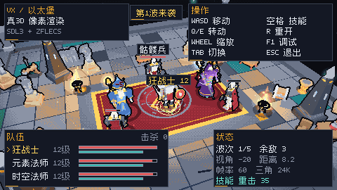
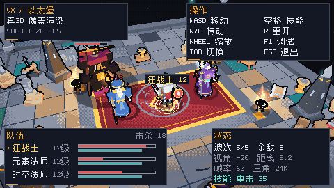
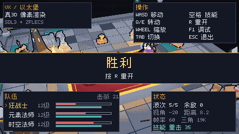
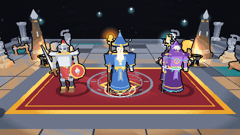
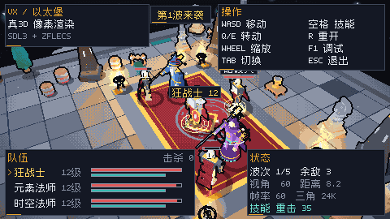

# VX / 以太堡

**真 3D 模型 + 像素画风 + 固定俯视可旋转第三人称 + 5 波战斗原型**

基于 Zig 0.17、SDL3 与 zflecs 的可玩垂直切片。角色、敌人、道具和环境都是**真实 3D 网格**（OBJ → 自带 VXM 格式），经过低分辨率软件光栅化、64 色调色板量化、Bayer 抖动和深度描边呈现像素画质感；战斗层提供自动普攻、主动技能、敌人 AI、倒下/复活和波次胜负。



> **分支关系**：PR #1（`feat/pixel3d-arena`）是渲染/相机/资源管线切片；本分支 `feat/combat-prototype` 在其之上加战斗与中文 HUD。工作树 `D:\code\zig\vx-combat`。
> 主分支 `main` 保留给数值与具体内容设计，这两个分支都没有向 main 提交；PR #1 合并后，本分支再 rebase 到 main 即可。



*第 5 波：深渊守卫 + 幽魂。红光是首领自带光源，角色仍走同一套 3D/描边管线。*



---

## 现在能跑什么

- **完整战斗循环**：5 波敌人、自动普攻、空格主动技能（35 AP）、目标锁定、伤害数字、敌人血条、击杀/波次 HUD、倒下/复活、清波回复、胜利/失败、R 重开。
- **三个可操作职业**：狂战士、元素法师、时空法师；各自有独立 3D 模型、武器、浮游物、程序化 idle/行走/施法姿态。
- **三种敌人 + 首领**：骷髅兵（近战）、幽魂（远程）、石魔像（坦克）、深渊守卫（第 5 波首领），都是带关节的 3D 网格。
- **中文像素 HUD**：Ark Pixel Font 12px 子集，混合中英文/数字排版；1440×810 窗口（480×270 3× 最近邻）下清晰可读。
- **固定俯视角可旋转第三人称**：Q/E、方向键或右键拖拽旋转 yaw；俯仰固定；滚轮缩放；相机平滑跟随当前英雄。
- **真 3D 渲染**：透视投影、近平面裁剪、z-buffer、平面光照、18 个点光源、距离雾、加色特效、贴地阴影、深色描边。
- **zflecs ECS**：编队、移动、动画 Pose、AP 回复、敌人 AI、英雄自动攻击、浮游物、自转装饰。
- **可复现资源管线**：Python 从程序化 OBJ 生成英雄/敌人，Kenney CC0 道具按 colormap 逐面烘焙为 VXM；运行时零 Python/Blender 依赖。
- **无窗口验证**：`--headless` 生成 PNG；`--auto` 可自动放技能跑完整局。



*左：狂战士；中：元素法师；右：时空法师。*

---

## 快速开始

### 环境

- Zig **0.17.0**
- Windows / macOS / Linux（SDL3 首次构建需要编译，耗时几分钟）
- 运行不需要 Python / Blender；只有改资源时才需要 Python 3 + Pillow

### 构建与运行

```powershell
# 默认 ReleaseFast，窗口 1440x810
zig build run

# 单元测试 + 无窗口集成测试
zig build test

# 无窗口：自动放技能跑完整局并截图
zig build run -- --headless --auto --frames 5000 --out docs/screenshots/victory.png

# 窗口模式跑 3 秒、截图并退出
zig build run -- --run-seconds 3 --out docs/screenshots/window.png

# Debug（调试器友好，帧率低）
zig build -Doptimize=debug
```

默认内部分辨率 **480×270**，窗口 3× 最近邻放大到 **1440×810**；最小可用分辨率 480×270。

### 常用参数

| 参数 | 说明 |
| --- | --- |
| `--headless` | 不创建窗口，渲染到 PNG |
| `--out PATH` | 输出路径，默认 `shots/vx.png` |
| `--frames N` | 无窗口模拟 N 帧后截图；窗口模式下自动退出 |
| `--run-seconds S` | 窗口模式运行 S 秒后截图退出 |
| `--auto` | 无窗口演示：每 1.5s 自动按一次技能 |
| `--cast` | 无窗口：最后一帧释放一次技能 |
| `--hero N` | 初始英雄 0/1/2 |
| `--yaw DEG` | 相机水平角，默认 -20° |
| `--pitch DEG` | 俯仰角，默认 40° |
| `--dist U` | 相机距离，默认 8.2 |
| `--res WxH` | 内部分辨率（≥480×270） |
| `--scale N` | 窗口整数倍率，默认 3 |
| `--lineup` | 三职业展示相机（文档用） |
| `--hide-hud` | 不画 HUD |
| `--debug` | 调试 HUD（实体/绘制像素/毫秒） |

### 操作

| 输入 | 行为 |
| --- | --- |
| WASD | 相对相机移动当前英雄 |
| Q/E、方向键左右、右键拖拽 | 旋转相机 yaw |
| 滚轮 | 缩放 |
| TAB | 切换到下一位存活英雄 |
| 空格 | 释放当前英雄技能（35 AP） |
| R | 重开整局（满血、清怪、回第 1 波） |
| F1 | 调试 HUD |
| F12 | 保存截图 |
| ESC | 退出 |



*旋转相机后，敌人、首领、粒子与遮挡关系仍然正确。*

---

## 战斗与占位数值

详细数值、波次和调参入口见 **[docs/COMBAT.md](docs/COMBAT.md)**。当前是**占位设计**，用于验证循环；正式数值请继续在 main 分支设计。

| 职业 | 生命 | 普攻 | 技能 | 定位 |
| --- | ---: | --- | --- | --- |
| 狂战士 | 148 | 18 / 1.45 | 重击 35 AP，2.4× | 近战、稳 |
| 元素法师 | 96 | 11 / 5.2 | 火球 35 AP，3.4× + 小 AOE | 远程爆发 |
| 时空法师 | 110 | 14 / 4.2 | 时光箭 35 AP，2.6× + 减速 | 控制 |

| 敌人 | 生命 | 伤害 | 特点 |
| --- | ---: | ---: | --- |
| 骷髅兵 | 44 | 5 | 近战，数量多 |
| 幽魂 | 58 | 7 | 3.8 距离远程 |
| 石魔像 | 92 | 10 | 慢速、高血 |
| 深渊守卫 | 220 | 13 | 第 5 波首领 |

击杀回复 4 HP；清波全队回复 25%、倒下的英雄 50% 复活；英雄倒下 7 秒后自动复活。

---

## 实现要点

### 渲染

- 480×270 软件光栅器：视图空间近平面 Sutherland–Hodgman 裁剪、屏幕空间边函数、1/w 深度、z-buffer、背面剔除。
- 逐三角形平面光照：环境光 + 冷月光 + 暖 key + 相机边缘光 + 点光源 + 距离雾；自发光材质用于法杖/眼睛/符文。
- 64 色手工调色板 + 4×4 Bayer 抖动；深度/ID 差描边；SDL 整数缩放。
- 角色/敌人是刚性关节蒙皮：每个部件绑定一个关节，`rig.zig` 每帧生成关节矩阵；低模像素风不需要软蒙皮。

### 战斗

- ECS 组件：`Hero` / `Enemy` / `Animation` / `Pose` / `Renderable` / `Shadow` / `LightSource` / `Mote` / `Spin`。
- Systems：Formation → Movement → EnemyAI → HeroCombat → Animation → Gauges → Motes → Spins。
- 战斗事件通过固定数组从 system 传到游戏层，游戏层生成伤害数字、粒子、击杀计数和清理死亡实体。
- Game 层管理波次队列、刷怪、休整、胜负、复活、相机和 HUD 状态。

### 中文像素字体

- 从 **Ark Pixel Font 12px** BDF 生成 12×12 字形子集（`tools/gen_cjk_font.py`）。
- 运行时混合排版：5×7 ASCII + 12×12 CJK，按 UTF-8 码点推进；缺字会画一个提示框，不会崩溃。
- 字体仅嵌入游戏用到的字形（112 个），源 BDF 不参与构建。OFL 许可见 `assets/fonts/OFL.txt`。

---

## 项目结构

```text
src/
  core/
    math.zig / color.zig / palette.zig / png.zig / font.zig / cjk_font.zig
  engine/
    model.zig / rig.zig / arena_mesh.zig / renderer.zig
  game/
    components.zig / systems.zig / hud.zig / game.zig
  platform/
    sdl.zig
  main.zig / root.zig
assets/
  models/*.obj|.mtl|.rig.json     英雄 + 敌人源模型
  baked/*.vxm                     运行时模型（内嵌）
  assets.zig                      自动生成清单
  kenney/                         Kenney CC0 原始 OBJ/贴图/许可
  fonts/                          Ark Pixel 子集说明 + OFL
tools/
  geometry.py / characters.py / bake_assets.py / gen_cjk_font.py
docs/
  ARCHITECTURE.md / COMBAT.md / screenshots/
```

---

## 资源管线

```powershell
# 需要 Python 3 + Pillow；运行时不需要
python tools/characters.py      # 生成英雄/敌人 OBJ/MTL/rig
python tools/bake_assets.py     # 烘焙 VXM + assets.zig + CREDITS
python tools/gen_cjk_font.py    # 从 Ark Pixel BDF 生成中文字形子集（可选）
zig build
```

Kenney 原始 OBJ/colormap 与 CC0 许可证在 `assets/kenney/`；烘焙后的模型在 `assets/baked/`，已提交。VXM 格式见 [docs/ARCHITECTURE.md](docs/ARCHITECTURE.md)。

> 本次没有依赖 Blender/MCP：角色/敌人由程序化建模脚本生成真 OBJ 网格。以后可在 Blender 中编辑 OBJ（保持 `o <joint>` 分组）再走同一条烘焙流程。

---

## 验证

- `zig build` / `zig build test` 通过；测试覆盖模型加载、字体 UTF-8 排版、无窗口创建/渲染和战斗刷怪。
- `--auto --frames 5000` 实测通关：第 5 波结束显示“胜利”，击杀 21。
- 窗口模式实测：480×270 逻辑分辨率、3× 放大、SDL 输入/计时/截图正常；战斗场景下 HUD 约 35–60 FPS（取决于机器/窗口合成）。
- 文档截图（`docs/screenshots/`）全部由 `--headless` 生成；窗口截图由 `--run-seconds` 生成。

---

## 已知限制 / 下一步

- 数值、技能树、装备、掉落、经验等**留给 main 分支设计**；当前只有占位数值和 5 波循环。
- 敌人 AI 只有“追最近英雄 + 冷却攻击”，没有寻路、仇恨策略、技能。
- 没有音频、存档、手柄、设置菜单。
- 倒下表现为灰色站立，不是倒地动画；复活是原型逻辑。
- 模型是程序化低模，可用 Blender 精修后替换；烘焙管线不变。
- 相机俯仰角固定是设计需求；`--lineup` 只是展示模式。

---

## 致谢与许可

- **Kenney** Mini Dungeon / Mini Arena，CC0 1.0；原始资源见 `assets/kenney/`，完整许可见 `assets/CREDITS.md`。
- **Ark Pixel Font** by TakWolf，SIL OFL 1.1；见 `assets/fonts/`。
- **SDL3**（castholm/SDL Zig 包）、**flecs / zflecs**（MIT）。
- 角色、敌人、程序化道具和代码为本项目生成/编写。

---

*Built with Zig 0.17 + SDL3 + zflecs. Real meshes, chunky pixels, five waves.*
