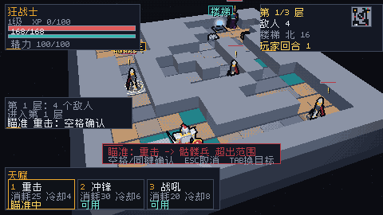
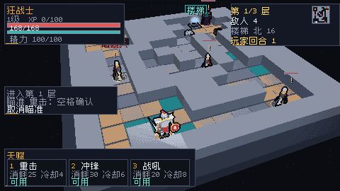
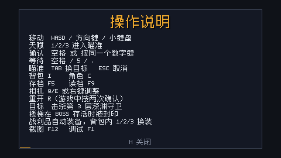
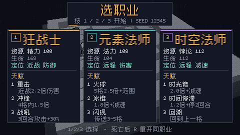

# QA3 — 瞄准、存档、帮助与机制回归

> 工作树 D:\code\zig\vx-qa3，分支 feat/tome-qa3，基线 5a4a305（已 fast-forward 到 origin/main）。
> 日期：2026-10-22；Zig 0.17.0（Windows x86_64，ReleaseFast 构建）。
> 本轮只做验证和文档：新增 src/qa3/tome_qa3.zig 与 build.zig 的 test-qa3 测试入口，**未修改任何游戏逻辑，未合并任何 PR**。

## 1. 结论摘要

- **P0：0 个。**
- **瞄准**：按 1 进入瞄准不消耗回合/资源；Esc 取消不消耗；有效目标用空格确认只 +1 回合、只扣一次资源；超距/无视线/缺资源不扣且保持瞄准；Tab 换目标不消耗；战吼/闪现/回溯立即释放；--auto 不进入瞄准。**同键实际是“确认”而不是验收文字写的“取消”（P1-1）**，5/. 在瞄准中也会确认（P2-1）。
- **存档**：TomeGame.saveRun/loadRun 能保存 hero/enemies/map/turn/战斗 RNG/背包/装备；读档后继续 20 回合与原局逐字段一致；坏档不覆盖当前局，坏档文件字节不变；缺 gear 文件回退空背包。**loot_rng 未保存，同一宝箱读档前后会掉出不同物品（P1-2）**；空 gear 对象 {} 会被当作空背包接受，可能静默清空装备（P1-3）；存档写入非原子（P2-2）。
- **H 操作说明**：窗口注入实测 H 打开、Esc 关闭、再按 H 两次关闭；回合数保持 1；文字无方框、无裁切；面板在 480×270 内完整显示。
- **机制**：第 3 层楼梯封印 0 回合/0 资源；Boss AOE 0.9 格，相邻格可躲、标记格 45 伤害；速度 150 连续两回合伤害 14.4/7.2（2 倍），速度 70 偶数回合跳过、奇数回合攻击；480×270 职业菜单/紧凑 HUD/帮助/角色/背包均未裁切（角色面板底行余量偏小，见第 8 节非阻断观察）。
- **自动局**：seed 12345 三职业 CLI --auto 均胜利（93/72/81 回合）；纯逻辑 QA2 bot 三职业也均胜利（100/72/82 回合）。
- **300 局批量**：193/300 胜利（64.3%），0 超时，0 不变量违规；狂战士 45%、元素法师 82%、时空法师 66%。

## 2. 命令与测试结果

~~~powershell
zig build --summary all          # 11/11 steps succeeded
zig build test --summary all     # 13/13 steps succeeded; 127/127 tests passed
zig build test-qa --summary all  # 3/3 steps succeeded; 76/76 tests passed
zig build test-qa3 --summary all # 3/3 steps succeeded; 128/128 tests passed
~~~

说明：

- test-qa3 是新增的 QA3 入口，包含 QA3 用例以及被 import 的既有 game/save/items 测试，所以总数可能高于 zig build test；本轮 test-qa3 为 128/128，覆盖的入口不同。
- 如果 Zig 缓存命中，test-qa / test-qa3 只打印 Build Summary，不重放 stdout；需要看 [qa2]/[qa3] 指标时使用新缓存目录重跑，例如：
  ~~~powershell
  zig build test-qa --summary all --cache-dir .qa-cache-qa2
  zig build test-qa3 --summary all --cache-dir .qa-cache-qa3
  ~~~
- Zig 0.17 在测试向 stderr 打印后会附带一行 failed command，这是已知工具链输出，不是测试失败；以退出码和 N/N tests passed 为准。

## 3. 瞄准（按 1 / Esc / 空格 / Tab / 自身技能 / --auto）

### 3.1 实测矩阵

| 场景 | 操作 | 结果 |
| --- | --- | --- |
| 进入瞄准 | 1 | turn 1→1，资源 100→100，冷却 0；瞄准框 active，目标超出范围时显示红色“超出范围” |
| Esc 取消 | 瞄准中按 Esc | turn 1→1，资源不变；日志“取消瞄准”；窗口进程不退出 |
| 同键 | 瞄准中再按 1 | turn 1→2，资源 100→75，日志命中；**实际为确认，不是需求文字要求的取消**（P1-1） |
| 空格确认 | 瞄准中按空格 | turn 1→2，资源 100→75，冷却 4→显示 3（set 4 后 endTurn 立即 tick 1） |
| 超距 | 目标距离 6，重击射程 1 | 红色“超出范围”；确认后仍瞄准，turn/资源不变 |
| 无视线 | 目标距离 2，中间放墙，冲锋射程 4 | 红色“视线受阻”；确认后仍瞄准，turn/资源不变 |
| 缺资源 | 资源 0，重击 | 红色“缺资源”；同键确认后仍瞄准，turn/资源不变 |
| Tab | 瞄准中按 Tab | 目标“骷髅兵”→“幽魂”，turn 不变 |
| 战吼 | 狂战士按 3 | 不进入瞄准，立即释放；turn +1，buff 3 回合 |
| 闪现 | 法师按 3 | 不进入瞄准，立即释放（本 seed 成功；失败时也不进入瞄准） |
| 回溯 | 时空法师按 3 | 不进入瞄准，立即回到 last_pos；turn +1，资源 -20 |
| --auto | 自动跑 91 步 | 每步 autoPlayStep 后 isAiming() 都为 false |

测试中把 res_per_turn 设为 0，才能精确核对“只扣一次 25 资源”；正常局 endTurn 会回复资源，所以面板差值会小于 25。这一点不是 bug。

### 3.2 同键语义（P1-1）

- 需求文字：Esc/再按同键取消。
- 当前实现：瞄准中按同一个数字键会确认释放。代码见 src/game/tome_game.zig:680-687（talentKey），README 操作表也写“空格 / 同键 = 瞄准中确认释放”（README.md:56）。
- 复现：窗口模式走到相邻敌人旁，按 1 进入瞄准，再按 1；玩家回合 +1、资源 -25、敌人掉血。若验收以“同键取消”为准，这是 P1 验收不一致；若 README 是准绳，则需要改验收文字而不是代码。本轮不改代码。
- 窗口 Esc 的实测截图： → （瞄准框消失，日志写“取消瞄准”，回合仍为 1，进程存活）。

### 3.3 5/. 在瞄准中确认（P2-1）

- SDL 把空格、5、. 都映射为 wait（src/platform/sdl.zig:108-112）；TomeGame 在瞄准中同时接受 confirm 或 wait（src/game/tome_game.zig:553-554）。
- 因此瞄准中按 5 或 . 会确认，而不是等待。复现：瞄准相邻敌人，按 5；turn +1、资源 -25、敌人掉血。
- 影响：误按等待键会释放技能；建议瞄准确认只接受空格/显式 confirm，或把 wait 从瞄准分支剔除。

## 4. 存档 / 读档

### 4.1 覆盖字段

~~~

保存：
  saves/tome-run.json   Sim：seed/class/floor/turn/state/kills/loot 计数/
                        xoshiro256 战斗 RNG/hero/enemies/blocked 地图/
                        stairs/chests/traps/aoe/日志
  saves/tome-gear.json  Inventory：12 格背包 + 6 槽 equipped（v1 实际 3 槽）

读档：
  loadRun 先读 Sim（失败直接返回，不动当前局）；
  再读 gear（仅 FileNotFound 回退空背包；malformed gear 报错返回；但 {} 例外，见 P1-3）；
  校验物品 ID 后才替换 sim/背包/装备/地图/视觉/HUD。

~~~

### 4.2 结果

| 检查 | 结果 |
| --- | --- |
| save→load 字段一致 | 通过；digest 去掉日志后逐字节一致（hero/enemies/map/turn/RNG/装备） |
| 背包/装备一致 | 通过；gear JSON 完全一致 |
| 读档后继续 20 回合 | 通过；每回合后 digest 一致，结束 turn=45、floor=2，未出现战斗 RNG 分叉 |
| 坏 Sim 档 | 当前局状态/装备不变；坏档文件字节完全不变 |
| 坏 gear 档（malformed JSON） | 当前局状态/装备不变；loadRun 返回并写“装备读档失败” |
| 空 gear 对象 {} | **被接受为空背包**，当前装备被清空；P1-3 |
| 缺 gear 文件 | 成功读入 Sim，背包为空；符合回退要求 |
| 战斗 RNG | 保存 xoshiro256 的 4×u64；读档后暴击/伤害序列一致 |
| loot RNG | **未保存**；读档时用 seed^turn 派生（P1-2） |

### 4.3 P1-2：loot_rng 未进存档，掉落序列分叉

代码：save.zig 的 SaveRoot 没有 loot_rng；tome_game.zig:307 在读档时执行

~~~zig
self.loot_rng = std.Random.DefaultPrng.init(
    loaded.seed ^ 0x9e3779b97f4a7c15 ^ @as(u64, loaded.turn));
~~~

而原局的 loot_rng 从 seed^0x9e3779b97f4a7c15 开始，按宝箱/击杀掉落次数推进。docs/SAVE.md:98 也明确写了“掉落 RNG 未保存”。

定向复现（test-qa3 的 “loot rng is not saved”）：

1. seed 12345、狂战士，清空敌人，把英雄放到宝箱 (10,3) 左侧 (9,3)。
2. F5/ saveRun。
3. 原局和读档局分别向右一步开同一个宝箱。
4. 输出：

~~~json
原局 gear: {"format":"vx-tome-gear","version":1,"len":1,"items":[6,...],"equipped":[null,null,null,...]}
读档 gear: {"format":"vx-tome-gear","version":1,"len":0,"items":[4,...],"equipped":[null,null,4,null,...]}
~~~

原局掉出物品 6（生命瓶），读档局掉出物品 4 并自动装备到饰品槽；两边仍是同一个回合、同一个宝箱，但背包/装备不同。影响：验收要求“读档后继续 20 回合与原局一致”且包含背包/装备时，不能通过；只比较 Sim 战斗状态时可以通过。

建议：把 loot_rng 的 4×u64 与 _seen 计数一起写入 sidecar（或并入 RunState 并升 version），并在读档后恢复；或者明确把验收降为“战斗 RNG 一致，掉落不保证”。

### 4.4 P1-3：空 gear 对象 {} 被当作合法空背包

- GearSave 的每个字段都有默认值（gear_save.zig:11-16），所以 JSON 解析器把 {} 填成 format=vx-tome-gear、version=1、len=0 的“空装备档”，随后 loadRun 的物品 ID 校验也全部通过。
- 结果：一个被截断/损坏成 {} 的 gear 文件不会报错，而是成功读档并把当前背包/装备替换为空。原局若已有物品，会静默丢失。
- 复现：携带 1 件物品存档，把 saves/tome-gear.json 写成 {}，F9；日志显示“读档”，背包变空。定向用例 test-qa3 的 “empty gear object is accepted as empty bag” 输出 inventory len=0。
- 影响：违反“坏档不覆盖”的验收；比 malformed JSON 更隐蔽，因为它看起来像一次成功的空背包读档。
- 建议：要求 format/version/len 字段必须出现（去掉默认值或做原始字段存在性检查）；只允许 FileNotFound 触发空背包回退，{} 应报错并保留当前局。

### 4.5 P2-2：saveRun 非原子

saveRun 先覆盖 tome-run.json，再写 tome-gear.json（src/game/tome_game.zig:254-266）；gear 写入失败时 sim 已经是新档，gear 还是旧档/缺失。F9 可能得到“新 Sim + 旧装备”的不一致组合。正常磁盘未触发；这是静态风险，建议临时文件 + rename，或先写 gear 再写 sim。

## 5. H 操作说明

### 5.1 窗口注入实测

启动：

~~~powershell
zig-out/bin/vx.exe --hero 0 --seed 12345 --run-seconds 20
~~~

用 PowerShell + user32 PostMessage 注入 H(0x48)、Esc(0x1B)、F12(0x7B)：

| 步骤 | 截图 | 结果 |
| --- | --- | --- |
| 初始 | docs/screenshots/qa3_win_hud.png | HUD，玩家回合 1 |
| 按 H | docs/screenshots/qa3_win_help.png | 帮助页，13 行说明 + “H 关闭” |
| 按 Esc | docs/screenshots/qa3_win_after_esc.png | 回到 HUD，进程存活，玩家回合 1 |
| 再按 H、H | docs/screenshots/qa3_win_after_hh.png | 关闭帮助，回到 HUD，回合仍为 1 |

结论：H 开关、Esc 关闭均通过；不消耗回合；Esc 在帮助页只关闭帮助，不退出进程。

### 5.2 文字与布局

- 帮助页在 480×270：面板 x=32..448、y=16..254；13 行从 y=58 开始，间距 13，最后一行到 y=214；footer y=236。全部在面板内。
- 截图无方框、无缺字；CJK 字形覆盖由既有 “tome hud: hint strings have embedded CJK glyphs” 测试保证。
- 帮助页是全屏模态，覆盖 HUD 是设计行为；关闭后 HUD 完整恢复。

## 6. 楼梯封印 / Boss AOE / 速度 / 布局

### 6.1 楼梯封印

- 第 3 层 Boss 存活时，英雄从相邻格走向楼梯：move 返回 false；floor 仍为 3；turn、资源不变。
- Boss alive 置 false 后同一步成功进入下一层。
- 与既有测试 “tome sim: boss seals the stairs until defeated” 一致。

### 6.2 Boss AOE 0.9 格

- 预警目标为英雄当前格；0.9 格按 Manhattan 距离比较，同格 dist=0 命中，相邻格 dist=1 > 0.9 安全。
- 定向测试：turn=2 时 aoe_armed=true，目标 (7,6)，英雄在 (6,6)，wait 后英雄 HP 不变（相邻安全）。
- 同格目标 (6,6)：wait 后英雄掉 45 HP（护甲 0）。
- 既有自动策略会优先走出标记格；300 局批量 0 超时、0 不变量违规，也侧面验证可躲。

### 6.3 速度 150 / 70

| 档位 | 第一回合（turn 1→2） | 第二回合（turn 2→3） | 结论 |
| --- | --- | --- | --- |
| 150 | 攻击 2 次，14.4 伤害 | 攻击 1 次，7.2 伤害 | 偶数敌方回合多一次行动 |
| 70 | 0 次，HP 不变 | 攻击 1 次 | 偶数敌方回合跳过 |

测试使用攻击 10、护甲 0 的假敌人，避免暴击/护甲干扰；伤害比例 14.4 : 7.2 正好 2:1。

### 6.4 480×270 布局

| 界面 | 截图 | 结果 |
| --- | --- | --- |
| 职业菜单 | docs/screenshots/qa3_menu_480x270.png | 三张卡 x=15..465、y=58..246；标题/seed/footer 完整 |
| 紧凑 HUD | docs/screenshots/qa3_hud_480x270.png | 左上卡、右上卡、日志、天赋栏均完整；右上卡右边框在 x=479 |
| 瞄准框 | docs/screenshots/qa3_aim.png | 红色超距提示 + 两行提示，位于日志与天赋栏之间，不重叠 |
| 角色面板 | docs/screenshots/qa3_character_480x270.png | 完整显示；最后一行天赋文字距底边约 2px，未裁切但余量偏小 |
| 背包 | docs/screenshots/qa3_inventory_480x270.png | 完整显示；底部操作提示在面板内 |

## 7. 自动跑局与 300 局批量

### 7.1 seed 12345 固定三职业

CLI --auto 结果（--frames 5000，每 10 帧一步）：

| 职业 | 结果 | 回合 | 楼层 | HP | 截图 |
| --- | --- | ---: | ---: | ---: | --- |
| 狂战士 | victory | 93 | 3 | 80 | docs/screenshots/qa3_auto_seed12345_h0.png |
| 元素法师 | victory | 72 | 3 | 52 | docs/screenshots/qa3_auto_seed12345_h1.png |
| 时空法师 | victory | 81 | 3 | 83 | docs/screenshots/qa3_auto_seed12345_h2.png |

纯逻辑 QA2 bot（无药水、直接 Sim 动作，test-qa 的固定报告）：

| 职业 | 结果 | 回合 | 楼层 | HP |
| --- | --- | ---: | ---: | ---: |
| 狂战士 | victory | 100 | 3 | 66/168 |
| 元素法师 | victory | 72 | 3 | 50/104 |
| 时空法师 | victory | 82 | 3 | 80/112 |

两条路径的差异来自：CLI TomeGame 自动步会用药水、处理掉落/装备，动作间隔也不同；QA2 bot 是纯逻辑基线。

### 7.2 300 局批量（100 seed × 3 职业）

| 指标 | 全部 | 狂战士 | 元素法师 | 时空法师 |
| --- | ---: | ---: | ---: | ---: |
| 局数 | 300 | 100 | 100 | 100 |
| 胜利 | 193（64.3%） | 45（45.0%） | 82（82.0%） | 66（66.0%） |
| 死亡 | 107 | 55 | 18 | 34 |
| 超时 | 0 | 0 | 0 | 0 |
| 平均回合 | 77.5 | 85.3 | 69.3 | 77.8 |
| 胜利平均回合 | 81.0 | — | — | — |
| 平均到达层 | 3.00 | 3.00 | 3.00 | 3.00 |
| 击杀总数 | 3302 | — | — | — |
| 掉落事件 | 3683 | — | — | — |
| 装备掉落/生效 | 1135 / 639 | 381 / 224 | 399 / 233 | 355 / 182 |

死亡楼层：F1=0，F2=0，F3=107。stairs_wins=0，193 胜全部来自 Boss 击杀。0 不变量违规；超时上限 1200 回合，0 超时。

### 7.3 文档基线漂移（P2-3）

- README.md:148 写“元素法师第 75 回合、时空法师第 84 回合”，当前 QA2 bot 为 72/82；QA2 文档同处写“剩 61/69 HP”，当前为 50/80。
- README.md:159 写“还没有确认取消”，但本轮已实测空格确认、Esc 取消、Tab 换目标。
- README.md:162 写“存档已有纯逻辑模块（未接 F5/F9）”，实际 F5/F9 已接入。
- docs/SAVE.md:4 仍写“尚未接入 UI / main”；:97 仍建议 F9 清空背包，实际已有 gear sidecar。

这些不影响运行，但会让玩家/后续 QA 误判功能状态；建议在后续文档 PR 修正。

## 8. 缺陷清单（P0/P1/P2）

### P0

无。

### P1-1 瞄准同键语义与验收文字冲突

- 症状：瞄准中再按同一个数字键会确认释放（turn+1、资源扣除），而不是取消。
- 复现：窗口/测试中站在相邻敌人旁，按 1，再按 1；或运行 test-qa3，看 “[qa3] FINDING P1”。
- 代码：src/game/tome_game.zig:680-687；README.md:56 明确写同键确认。
- 判定：按本轮验收文字（Esc/再按同键取消）是 P1；按 README 则是文档/验收口径不一致。需要产品确认后再改代码或改验收。
- 建议：二选一——把同键改为 cancelAim，或把验收改为“空格确认、同键确认”，并同步 README/测试。

### P1-2 loot_rng 未保存，掉落/背包不可复现

- 症状：同一宝箱，读档前后掉出不同物品；原局生命瓶，读档局饰品并自动装备。
- 复现：见 4.3；或直接运行 test-qa3 的 “loot rng is not saved” 用例。
- 代码：save.zig SaveRoot 无 loot_rng；tome_game.zig:307 用 seed^turn 派生；docs/SAVE.md:98 已声明。
- 影响：读档后继续 20 回合时，Sim 战斗状态一致，但背包/装备可能分叉，不满足“RNG/背包/装备”全量一致的验收。
- 建议：保存 loot_rng 的 4×u64 与 _seen 计数，或在验收中明确“掉落不保证复现”。

### P1-3 空 gear 对象 {} 被当作空背包接受

- 症状：把 gear 文件写成 {}，F9 不报错，背包/装备被清空。
- 复现：带 1 件物品存档，覆盖 saves/tome-gear.json 为 {}，F9；或运行 test-qa3 看 “[qa3] FINDING P1: gear file {} accepted as empty loadout”。
- 代码：gear_save.zig:11-16 全字段默认值；loadRun 只校验物品 ID 范围，不校验字段是否实际出现。
- 影响：部分损坏/截断的 gear 文件会静默丢装备，违反坏档不覆盖。
- 建议：要求 format/version/len 显式存在；{} 报错并保留当前背包。

### P2-1 5/. 在瞄准中也会确认

- 症状：瞄准中按 5 或 . 会释放技能并消耗回合/资源，而不是等待/取消。
- 复现：瞄准相邻敌人，按 5；turn+1、资源-25、敌人掉血。
- 代码：sdl.zig:108-112 把 5/./space 都设 wait；tome_game.zig:553 在瞄准中把 wait 当 confirm。
- 建议：瞄准分支只接受 space/confirm；5/. 保持等待或显式取消。

### P2-2 saveRun 非原子

- 症状：先写 sim、再写 gear；gear 写失败会留下“新 Sim + 旧/缺 gear”。
- 复现：把 saves/tome-gear.json 变成目录或设为不可写，F5；tome-run.json 已更新，gear 写入失败并记录“装备存档失败”。
- 代码：src/game/tome_game.zig:254-266。
- 建议：临时文件 + rename，或先写 gear 再写 sim，失败时回滚/保留旧档。

### P2-3 文档基线漂移

- 见 7.3；涉及 README.md:148/159/162、docs/SAVE.md:4/97、docs/QA_TOME2.md:162。
- 不影响运行，但会误导验收；建议后续文档 PR 修正。

### 非阻断观察

- 角色面板在 480×270 下最后一行天赋文字距底边约 2px；截图可见、未裁切，但建议增加 4–6px 余量（docs/screenshots/qa3_character_480x270.png）。
- 帮助页为全屏模态，覆盖 HUD 属设计选择；如果产品要求“帮助不挡关键 HUD”，需要改成半屏/侧栏，当前实现不满足该解释。

## 9. 未覆盖 / 限制

- 窗口 F5/F9 注入未做；F5/F9 通过 TomeGame.saveRun/loadRun 直接测试，键位映射只做了代码核对（src/platform/sdl.zig:126-127，src/main.zig:322-323）。窗口 H/Esc 与 1/Esc 已实际注入。
- 300 局批量使用确定性 QA2 bot（无药水、启发式），不是人类玩家或最优策略；胜利率为该 bot 的基线。
- 存档坏档覆盖了损坏 JSON、malformed gear、空对象 {}、缺 gear；未做磁盘满/断电/并发写等故障注入。
- 瞄准的 Tab 只覆盖两个目标的循环；未覆盖大量敌人、目标死亡后的自动回落。
- 布局为截图人工检视 + 坐标核算；未做逐像素自动裁切检测或 4K/缩放测试。
- 本轮未改游戏代码，因此上述 P1/P2 均只记录复现，不包含修复。

## 10. 复现命令汇总

~~~powershell
# 构建与测试
zig build --summary all
zig build test --summary all
zig build test-qa --summary all
zig build test-qa3 --summary all

# 480x270 截图
zig build run -- --headless --seed 12345 --frames 2 --start-menu --out docs/screenshots/qa3_menu_480x270.png
zig build run -- --headless --hero 0 --seed 12345 --frames 2 --out docs/screenshots/qa3_hud_480x270.png
zig build run -- --headless --hero 0 --seed 12345 --frames 2 --out docs/screenshots/qa3_help.png --help-screen
zig build run -- --headless --hero 0 --seed 12345 --frames 2 --out docs/screenshots/qa3_aim.png --aim 0
zig build run -- --headless --hero 0 --seed 12345 --frames 2 --out docs/screenshots/qa3_character_480x270.png --character --loot 8
zig build run -- --headless --hero 0 --seed 12345 --frames 2 --out docs/screenshots/qa3_inventory_480x270.png --inventory --loot 8

# seed 12345 三职业 CLI 自动局
zig build run -- --headless --hero 0 --seed 12345 --auto --frames 5000 --out docs/screenshots/qa3_auto_seed12345_h0.png
zig build run -- --headless --hero 1 --seed 12345 --auto --frames 5000 --out docs/screenshots/qa3_auto_seed12345_h1.png
zig build run -- --headless --hero 2 --seed 12345 --auto --frames 5000 --out docs/screenshots/qa3_auto_seed12345_h2.png
~~~

窗口 H/Esc/1/Esc 注入的脚本较长，核心是 user32.PostMessage：H=0x48、Esc=0x1B、1=0x31、F12=0x7B；截图保存在 docs/screenshots/qa3_win_*.png。

## 11. 变更文件

- src/qa3/tome_qa3.zig：QA3 测试/诊断（瞄准、存档、帮助、速度、AOE、楼梯）。
- src/qa3_test.zig：test-qa3 入口。
- build.zig：新增 test-qa3 step；默认 test 不变。
- docs/QA_TOME3.md：本报告。
- docs/screenshots/qa3_*.png：本轮证据截图。

未修改任何 src/game/* 游戏逻辑。