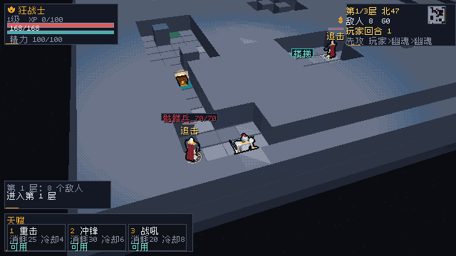
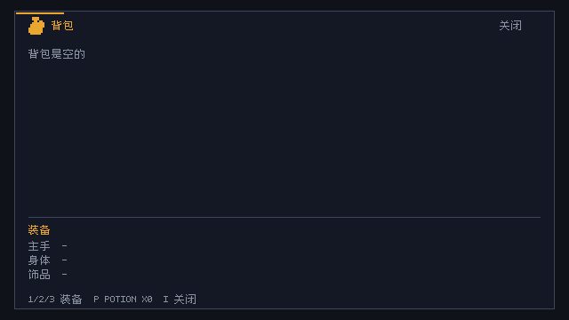

# HUD 图标

## 来源

- Kenney Board Game Icons（CC0）：bag/pouch、hero/crown、coin/dollar、sword、shield、potion/flask、time/hourglass、fire/campfire、skull、heart
- Kenney Game Icons（CC0）：gear

原始 64px PNG 在 assets/icons/board 与 assets/icons/game；许可见同目录 License-*.txt。

## 生成

~~~powershell
python tools/gen_icons.py
~~~

脚本把 64px 图标缩到 12×12、按 alpha 阈值转 1-bit 行位图，写入 src/engine/icons.zig。改图标必须改脚本再生成，不手改生成文件。

## 使用

Renderer 增加：

~~~zig
r.drawIcon(.coin, x, y, palette.gold, 1);
~~~

当前接入：

- 左上职业名：hero 1×
- 右上金币：coin 1×
- 背包/角色面板标题：bag/hero 2×
- 商店 GOLD：coin 2×
- 设置标题：gear 2×
- 死亡/胜利标题：skull/hero 1×

## 截图

## 验收

- 640×360：标题图标 2× 不裁切、不糊，不抢文字。
- 480×270：HUD 本身仍会裁切（见 docs/RENDERING.md），图标不是新增瓶颈。
- 图标只做辅助，关键状态仍保留中文/ASCII 文字。
