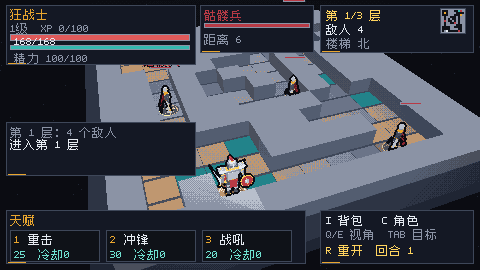
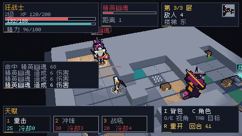
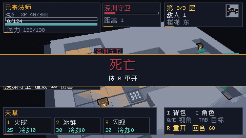

# UX 审查（第二轮）：在当前 turn-based 构建上重跑前三分钟

> 审查对象：`feat/run-critic2` @ `09b6d15`（当前 main，含 PR #5 小地图/Tab/胜利、PR #6 手动换装）
> 构建：`zig build` 通过（exit 0）；`zig-out/bin/vx.exe`，内部 480×270、窗口 3×
> 方法：headless 截图 + 自动跑局 + 窗口模式键位注入实测（两次会话，约 2 分钟）
> 范围：**当前 turn-based 回合制构建**。旧实时竞技场（`--arena`）不在本文范围内。
> 结论：**"RUN 还不存在"这个问题已经解决；现在的问题是"RUN 有了，但前两分钟里玩家会不断按到没有反应的东西，而且有两个键会直接毁掉整局"。**

## 0. 结论先行

### 0.1 一眼看懂程度（5 分制）

| 问题 | 分数 | 一句话判断 |
| --- | :---: | --- |
| 格子 | 2/5 | 能看出"有格子"（地砖倒角、脚底环），但读不出"我在哪一格、下一步落到哪一格"；网格线在 480 下不到 1px。 |
| 回合 | 1/5 | 回合数只在右下角"R 重开 回合 N"里；没有"你的回合/敌人行动"，没有先攻，没有输入锁。 |
| 目标 | 2/5 | 一进关就自动锁定 6 格外的敌人；有名字牌和目标卡，但世界里没有"选中"语法，也没有意图。 |
| Tab 选目标 | 3/5 | 能循环、名字牌会跟着换；但目标卡不提示 Tab、没有四角框，超出天赋射程时按 1 会静默失败。 |
| 小地图 | 1/5 | 26×26px（2px/格），无图例、无北针、无朝向；信息有，读不出来。 |
| 天赋栏 | 3/5 | 名字/消耗/冷却都有了；没有范围/伤害/不可用原因，消耗数字没有标签。 |
| 角色 / 背包 | 2/5 | 面板存在、能读；没有比较、品质、槽位，装备变化是静默的。 |
| 死亡 / 胜利 | 1/5 | 只有"死亡/按 R 重开"两行；死因日志正好被结算条盖住。 |

### 0.2 五个 P0（详见第 6 节）

1. **输入契约会毁局**：面板里按 Esc 直接退出游戏；按 R（reference roguelike 的"休息"）直接把整局重置。实测：Esc 直接退出进程，R 直接清空进度。
2. **回合状态与方向感不成立**：回合只剩一个数字；相机自由旋转、默认 -20°、无北向；"楼梯 北"是绝对方向，不是屏幕方向。
3. **HUD 仍占 45.6%**（旧实时版 45.9%），日志压在战场中央，世界名字牌和"楼梯"标签会被 HUD 切掉。
4. **敌人意图/危险信息缺失**：只有相邻敌人脚下一个 5×7 的"!"；没有预计伤害、远程 LOS、AOE 预警；Boss/精英与普通共用 22×3 血条。
5. **无效操作零反馈**：撞墙、超距天赋、面板内移动、5/. 都是静默的。实测 6 次 W 只有 2 次移动，后 4 次屏幕没有任何变化。

### 0.3 已解决的旧 P0（明确对账）

- ✅ **旧 P0-5 中文缺字：已解决。** 字体从 112 字形扩到 **381 字形**（`src/core/cjk_font.zig`），本轮所有截图 0 方框；UI 字符串扫描只剩 `无法装备` 的"无"（未触发路径）和校验文案里的"既/概"。建议补一个"UI 字符串 → 字模覆盖"测试，防止回退。
- ✅ **旧 P0-3 的"文案层"已解决。** 队伍/波次/自动攻击/FPS/12 级/队伍切换全部消失；单角色、楼层、天赋、日志、目标卡都在（Tab 现在用于切目标，不再是切队友）。
- ⚠️ **旧 P0-3 的"屏幕预算层"未解决**：六个面板合计 45.6%，旧版四个面板 45.9%，**等于没做减法**。
- ◐ **旧 P0-1（格子/回合）部分解决**：网格缝、脚底环、回合数字、小地图有了；回合状态、先攻、90° 相机、北针、悬停格仍缺。
- ◐ **旧 P0-2（天赋目标）部分解决**：Tab 能循环目标；但火球仍以敌人为中心自动 AoE、闪现随机落点、无预览/取消。
- ❌ **旧 P0-4（敌人意图）未解决**：仍只有名字牌和相邻"!"。

## 1. 环境、命令与实测记录

### 1.1 构建与截图

```powershell
zig build                                                   # exit 0
zig-out/bin/vx.exe --headless --frames 2 --out docs/screenshots/review2_start.png
#  run headless: 480x270 tris=13809 drawn=218107 floor=1 turn=1 hp=168
zig-out/bin/vx.exe --headless --auto --frames 120 --out docs/screenshots/review2_fight.png
#  run headless: 480x270 tris=10025 drawn=241394 floor=1 turn=13 hp=154
zig-out/bin/vx.exe --headless --frames 2 --loot 8 --character --out docs/screenshots/review2_character.png
#  run headless: 480x270 tris=13809 drawn=218107 floor=1 turn=1 hp=168
```

补充证据（不属于交付命令，但用于本文结论）：

```powershell
zig-out/bin/vx.exe --headless --frames 2 --loot 8 --inventory --out docs/screenshots/review2_inventory.png
zig-out/bin/vx.exe --headless --auto --frames 1200 --out docs/screenshots/review2_victory.png
#  floor=3 turn=80 hp=51（胜利）
zig-out/bin/vx.exe --headless --auto --frames 2000 --hero 1 --out docs/screenshots/review2_death.png
#  floor=3 turn=68 hp=0（死亡）
```

### 1.2 窗口模式实测（键位注入，约 2 分钟）

本机没有可用的物理键盘注入通道（`SendKeys` 抛 "操作成功完成"），改用窗口消息注入 `WM_KEYDOWN/WM_KEYUP`（SDL 正常事件路径），并用游戏内 F12 截图逐步取证。**这不是人类玩家测试，但按键路径与真实键盘一致**；所有"没反应"结论都能从截图和代码双向验证。

> 两次窗口会话合并（第一次带 `--loot 8`，第二次干净开局）。

| 时间 | 操作 | 结果 |
| --- | --- | --- |
| 0:00 | 启动 | 直接进入第 1 层，回合 1；目标卡已经自动锁定 6 格外的骷髅兵；"回合 1"在右下角。 |
| 0:05 | W | 回合 2，距离 4。 |
| 0:06 | W | 回合 3，距离 2。 |
| 0:08–0:12 | W ×4 | **回合仍是 3，角色不动，日志没有任何一行。** |
| 0:20 | Tab ×3 | 目标从距离 2 换到距离 6 的另一个骷髅兵；名字牌移动；世界中没有选中框。 |
| 0:30 | 1（重击） | **无任何反应**：回合 3 不变、精力不减、无日志（目标距离 6 > 重击射程 1）。 |
| 0:45 | I → 1（生命瓶） | 背包全屏；列表完全没变；"不能装备"的日志被面板盖住，关掉背包后才看到。 |
| 1:00 | C → WASD | 角色面板全屏；WASD 完全无反应；面板右上写"关闭"，但没写按哪个键。 |
| 1:10 | Esc（面板内） | **进程直接退出，整局丢失。** 实测（`--loot 8` 会话）复现。 |
| 重开 | R | 瞬时回到回合 1，同 seed、同职业、装备清空；无确认、无结算。 |
| — | 5 / . | 无反应（等待只有空格）。 |

> 结论：前两分钟里，玩家至少会遇到 4 类"按了没反应"和 2 次"一个键毁掉整局"。这比"画面不好看"严重得多。

## 2. 格子 / 回合 / 目标 / Tab：能不能一眼看懂

### 2.1 格子：有"格子的感觉"，没有"格子的状态"

**读得出**：

- 地砖有 0.012–0.022 的倒角和 0.08 的暗色边缘（`src/engine/arena_mesh.zig:127-147`），墙/柱子/水域/火盆和地板有明确色差。
- 每个 actor 有脚底环：玩家金色 `rune_circle` 0.40、敌人红色 0.34（`src/game/run_game.zig:642-661`），阴影也分大小。
- 相机固定俯仰 40°，13×13 的房间能整屏看到。

**读不出**：

- 网格缝只有 **0.018 世界单位**（`src/engine/arena_mesh.zig:327-353`）。按默认相机（distance 12.3、fov 0.76、高 270）算，屏幕焦距约 339px，格心 1 格约 27–35px，**0.018 单位 ≈ 0.5–0.6px**。这是"亚像素缝"，不是 1px 网格；在截图里只能靠地砖倒角猜格子。
- 没有悬停格、没有可走/阻挡/危险格高亮、没有移动路径预览、没有技能范围预览。鼠标只用于右键拖相机和滚轮缩放，全程不参与选格。
- 没有"我这一格"的强标记：金色脚环和敌人红环都是加色光晕，形制相同；英雄模型本身没有朝向楔形、没有名字、没有箭头。玩家密集时（`review2_fight.png`）只能靠"相机偏向谁"判断自己。
- 相机自由旋转（Q/E 连续、右键拖拽），默认 yaw -20°（`src/game/run_game.zig:99-104`、`src/main.zig:378-380`），**没有 90° 吸附、没有北向指针**。默认画面里的地砖是斜的，"上"不是"北"，而移动键是固定的世界方向（`src/platform/sdl.zig:102-105`）：旋转 180° 后按 W 仍向北走，屏幕上的"上"却是南。

**建议**：把网格缝加到 0.03–0.04 单位（约 1–1.4px）并提高对比；加入鼠标/键盘悬停格 + 玩家所在格四角括号；相机 90° 吸附 + 右上角北针；给玩家加朝向楔形（0.9 格环上 60° 扇形）。**验收**：5/5 能在 30 秒内指出自己的格子和相邻四格；20 次移动 ≥18 次落在预期格；旋转 90° 后 20 次移动 0 次方向错误。

### 2.2 回合：只有一个数字，没有"谁在行动"

- 回合数唯一的可见位置是右下角操作卡最后一行：`R 重开  回合 13`（`src/game/run_hud.zig:154`）。它和"重开"在同一行、同一个面板里，玩家很容易读成"R 重开回合"。
- **没有**"你的回合 / 敌人行动"状态，**没有**敌人回合的输入锁或短暂提示。敌人阶段在 `sim.move()/wait()` 内部同步执行（`src/game/run_sim.zig:417-472`），玩家看到的是敌人位置直接插值过去；如果你当时在看日志/天赋栏，就会错过整轮敌人行动。
- **没有先攻条**。速度机制实际上是"死"的：敌人速度 80–120（`src/game/run_sim.zig:108-115`），代码里的 `≥150 每 2 回合多动一次 / ≤75 少动一次`（`src/game/run_sim.zig:460-465`）**永远不会触发**；角色面板却显示"速度 100"。玩家会把它当成一个没有作用的数字。
- 没有回合开始/结束的视觉或听觉提示（游戏没有音频），也没有"你等待了一回合"的 toast。

**建议**：顶部中央常驻 130×16 状态条：`你的回合 13` / `敌人行动…`；敌人阶段 0.25 秒输入锁 + 当前 actor 高亮；目标卡或状态条右侧显示"下一个行动：幽魂（×1）"；把速度要么做成可见的 ×2 徽章，要么先从面板移除。**验收**：任意时刻 5/5 能说出现在是谁的回合；5/5 能说出下一个行动的敌人；8 个敌人的回合在 1 秒内演完且不吃输入。

### 2.3 目标与 Tab：能切换，但没有"选中"语法

- 一进关 `currentTarget()` 就返回 20 格内最近的敌人（`src/game/run_game.zig:411-416`），所以目标卡在玩家做任何决定前就已经显示"骷髅兵 距离 6"；这个查找**不考虑 LOS**，隔墙也会锁定。
- Tab 走 `cycleTarget()`（`src/game/run_game.zig:418-434`），按敌人数组顺序循环，跳过死亡。**能切**，但：
  - 目标卡本身不提示 Tab；提示在右下角操作卡里，和"Q/E 视角"同一行。
  - 世界里没有选中框/箭头/标记，只有目标头顶多一个 11px 高的名字牌（`src/game/run_game.zig:590-595`）。名字牌和血条同色系，且可以被顶部目标卡切掉（见 `review2_hud_clip.png` 中"幽魂"只有下半截）。
  - 目标卡只显示名字、血条、`距离 N`，没有"重击射程 1 / 冲锋 4 / 火球 5"的提示；玩家必须记 README。
  - 选中目标超出射程时，`pickTarget()` 会**悄悄回落到最近敌人**（`src/game/run_sim.zig:658-666`），而不是报错或取消。也就是说"Tab 选的目标"在施法瞬间可能不是你以为的那个。
  - 按 1 且没有合法目标时，`useTalentOn()` 直接 `return false`，**没有日志、没有 HUD 闪烁、没有资源/冷却变化**。实测目标距离 6 时按 1，前后画面除火把闪烁外完全一样。

**建议**：目标格加四角括号（与脚底环不同形）；目标卡写"Tab 切换 · 射程 1"；不可用时把原因写进目标卡（`目标超出重击射程（6 > 1）`）；取消"回落最近敌人"，改成"目标无效 → 请重新选目标"。**验收**：5/5 能在 3 秒内指出当前目标及其所在格；10 次 Tab 后按 1，10/10 命中玩家以为的那个敌人；10 次越界施法 10 次有明确原因。

## 3. 小地图、楼梯提示、敌人血条/危险标记

### 3.1 小地图：信息在，但读不出来

- 13×13 格，每格 **2×2px**，整张图 **26×26px**（`src/game/run_hud.zig:95-115`），放在楼层卡右上角；占屏 0.5%。
- 只有颜色：墙=muted、楼梯=cyan、宝箱=gold、玩家=cream、敌人=red、地板=deep。**没有图例、没有北针、没有朝向、没有悬停、没有点击**；墙和地板都是深色，在 3× 放大后仍要凑近看。
- 地图显示**全图**：从第 1 回合起就能看到所有敌人、宝箱和楼梯位置，没有战争迷雾。对 13×13 单房间来说可以接受，但它让"探索"和"被伏击"都不存在。
- 相机旋转时小地图不转，也没有北针，所以"地图上的上"和"屏幕的上"可以相差 90°。

**建议**：至少 3px/格（39×39px），加图例（4 个色块 + 文字太贵，可做成 hover 说明）、玩家朝向三角、北针；如果保留全图，就在楼层卡写"已探明"。**验收**：5/5 能在 10 秒内用小地图指出楼梯方向和最近的敌人；旋转相机后 5/5 仍能对准。

### 3.2 楼梯：三种提示，方向是"世界方向"

楼梯的提示其实做了三层：

1. 世界里的青色光柱 + `stairs_down` 模型 + 头顶"楼梯"标签（`src/game/run_game.zig:563-572`）。
2. 楼层卡第三行 `楼梯 北` / `楼梯 东`（`src/game/run_sim.zig:763-769`）。
3. 小地图上的青色 2×2 点。

问题是：

- 方向是**绝对世界方向**，而相机可以自由旋转。默认 yaw -20°，屏幕上的"上"已经偏了 20°；按 Q 转 90° 后，"楼梯 北"和屏幕方向完全对不上。没有北针可以校正。
- "楼梯"标签没有屏幕边界夹取（`src/game/run_game.zig:563-572` 只检查深度），楼梯靠近右边缘时标签会被切掉——`review2_hud_clip.png` 中只剩"楼"字的左半。
- 站上楼梯会**立刻下楼**（`src/game/run_sim.zig:354-357`），没有"按 > 下一层"的确认。想绕开楼梯走位时很容易误触；更严重的是**第 3 层踩到楼梯直接胜利**（`nextFloor()` 里 `floor > floors` 就 `victory`，`src/game/run_sim.zig:404-409`），Boss 可以完全不打。
- 楼层卡只写"敌人 N"，清层后没有"本层已清，可以下楼"的提示；玩家要靠自己数。

**建议**：方向改为屏幕相对（"楼梯 右上"）或加北针；标签做屏幕内夹取 + 避让顶部卡；站上楼梯显示"按 > 下一层 / 按 Esc 取消"；第 3 层楼梯在 Boss 存活时不可用（或提示"守卫未死"）；清层时给 1 行 toast。**验收**：0 次误触下楼；5/5 知道本层是否已清；0 次跳过 Boss；楼梯标签 0 次出屏。

### 3.3 血条与危险标记：22×3 的条 + 一个 "!"

| 信息 | 现在 | 缺什么 |
| --- | --- | --- |
| 敌人血条 | 22×3px，红色填充，无数字（`src/game/run_game.zig:584-589`） | 数字/百分比、精英/Boss 区分、速度徽章 |
| 危险标记 | 相邻敌人脚下一个 5×7 的 `!`（`src/game/run_game.zig:596-600`） | 远程 LOS/威胁格、预计伤害、AOE 预警 |
| 目标信息 | 名字牌 + 目标卡名字/血条/距离 | 意图、抗性、技能、命中率 |
| 状态 | 无 | 减速/眩晕/增益的图标和剩余回合 |

具体问题：

- "!" 只判断曼哈顿距离 == 1，所以**幽魂（射程 3）和精英幽魂（射程 4）在 2–4 格时完全没有危险提示**；它们可以站在你视野里打你，而屏幕只闪一下红、日志写一行"幽魂 造成 4 伤害"。
- 血条宽度固定 22px、高度 3px，**Boss 420 HP 和骷髅 70 HP 看起来一样长**；精英/普通也只在模型大小上差 1.18→1.25/1.38，没有徽章。
- 没有预计伤害。reference roguelike 玩家最需要的"我走过去会不会被打、打多少、会不会被多打一次"完全读不到。
- 没有状态图标：`slow_turns/stun_turns` 只存在于 sim，HUD 不显示；玩家不知道减速还剩几回合。
- 没有 Boss AOE 预警，也没有"看不见的敌人显示 ?"。

**建议**：相邻攻击图标 + 预计伤害（`-6`）；远程画 LOS 射线和受威胁格；Boss/精英血条加边框 + 常驻名字；目标卡加"意图：攻击 -6"；状态 8×8 图标 + 回合数。**验收**：5/5 能说出相邻敌人下回合做什么；10 次伤害预告误差 ≤1；Boss AOE 提前 1 回合标出；没见过面的敌人不泄露意图。

## 4. 天赋栏 / 角色 / 背包 / 装备：可发现性与信息层级

### 4.1 天赋栏：数据齐了，解释没齐

- 三个槽 90×32，显示键位、名字、`25`、`冷却0`（`src/game/run_hud.zig:136-148`）。
- 问题：
  - `25` 是精力消耗，但**没有标签**；`冷却0` 在就绪时也一直显示，占掉了本该放"就绪"的位置。
  - 就绪/不可用**只靠颜色**（cream vs muted、cyan vs red）和边框，没有文字原因。精力不足时玩家不知道为什么按 1 没反应。
  - 没有范围/伤害/状态说明。玩家不知道"重击"只能打相邻、"冲锋"能打 4 格、"火球"是 AoE。
  - 数字仍是 5×7 ASCII（`src/core/font.zig:4-6`），和 12px 中文混排时明显偏小；关键资源数字应该更醒目。
- **建议**：槽内写"重击 · 精力 25 · CD 0"，不可用时写"精力不足 12/25"；选中槽在栏上方显示一行"射程 1 · 2.2× 攻击"；资源条数字放大到 12px。**验收**：5/5 能说出每个槽的消耗、冷却和不可用原因；10/10 冷却回合数与实际可再用回合一致。

### 4.2 角色面板：能看，但不能比较

- C 打开的是**全屏不透明**模态（`src/game/run_hud.zig:158-201`），战场完全消失；关闭只能再按 C（或 I 切背包），右上角只写"关闭"，没写键位。
- 内容：六属性、三个装备槽、生命/资源/攻击/护甲/暴击/速度/回复；**没有职业、等级、XP、回合、天赋、状态**。
- 装备只显示名字（"主手 铁剑"），**没有属性、品质、对比、词条**；玩家无法判断"要不要换"。
- 数值是 5×7 ASCII，标签是 12px 中文，视觉上标签比数值更重，层级反了。
- 在面板里按 Esc 会退出游戏（见 P0-1）。

**建议**：半屏抽屉（保留战场左/上 1/3）；标题写"角色（C / Esc 关闭）"；加职业/等级/XP/回合；装备行显示关键属性 + 与当前装备的绿色/红色 delta；数值用 12px 或 2× 字模。**验收**：5/5 能在 10 秒内说出"这件甲比身上的好多少"；面板打开/关闭 0 回合消耗、0 输入丢失；5/5 知道怎么关。

### 4.3 背包与装备：信息最少、最容易误解的一块

- I 打开全屏列表：只有名字，最多显示 12 件，前 3 件带 `1/2/3` 前缀（`src/game/run_hud.zig:203-215`）。**没有图标、品质、槽位、属性、数量、已装备标记、对比、使用/丢弃**。
- `1/2/3` 是**背包序号**，不是装备槽：按 1 实际尝试装备"第 1 件物品"。如果第 1 件是药水，会 push 日志 `生命瓶 不能装备`，但**日志在面板下面，玩家看不到**——实测按 1 后画面完全没变，关掉背包才看到那行日志（见 `review2_inventory.png` 与实测）。
- **自动装备是静默的**：`grantDrop()` 在"更好"时直接 `inventory.equip()`（`src/game/run_game.zig:318-330`），只写"获得 皮甲"，不写"装备 皮甲"，也不显示 HP/攻击的变化。实测开局 `--loot 8`：日志只有"获得 铁剑 / 秘银甲 / 生命瓶"，角色面板却已经是 168/203（从 168/168 涨上来），玩家不知道发生了什么。
- 药水在 HP < 35% 时**自动喝**（`src/game/run_game.zig:359-361`），玩家不能决定什么时候喝、喝哪一瓶。
- 面板底部提示"数字键 1/2/3 装备；I 关闭"——没有 Esc，且与战斗热键同键，需要记忆上下文。

**建议**：列表每行加槽位/品质/主属性；选中显示与当前装备的 delta；装备成功写日志 + 2 秒 toast + "生命 168→203"；把"自动装备"改成"拾取后提示按 1 装备"或至少在日志写"自动装备 铁剑"；药水改成手动使用（或明确写"自动使用"）；右下角写"I / Esc 关闭"。**验收**：5/5 第一次掉落后 30 秒内完成一次装备；装备后 0.5 秒内看到数值变化；非装备项按 1 有明确原因；0 次"不知道为什么血上限变了"。

### 4.4 信息层级结论

当前三个面板各自为政：角色页不显示等级/职业，背包不显示属性，天赋栏不显示范围。玩家要在三个全屏页之间来回切换才能拼出一个 Build。建议建立一套共享的"物品行"组件（名字 + 槽位 + 品质 + 主属性 + delta）和一套共享的"角色头"（职业/等级/HP/资源/回合），所有面板复用；**同一屏只保留一个金色标题**这条旧规则仍然适用。

## 5. 第 1 层前 2 分钟、死亡/胜利反馈、重开成本

### 5.1 前 2 分钟实际发生了什么

见 §1.2 的时间线。概括成三句话：

1. **第 1 分钟**：玩家会先按 WASD。6 次 W 只有 2 次移动，另外 4 次是撞墙且**毫无反馈**；玩家会怀疑键盘/游戏卡了。
2. **第 2 分钟**：玩家会试 Tab 和 1。Tab 有反应（名字牌换了），1 没反应（距离 6 > 射程 1），没有原因；接着会按 I/C，进入全屏面板，发现 WASD 也不能用；最后按 Esc 想关面板——游戏退出。
3. **如果活下来**：走到敌人旁边撞它、按 1，才会第一次看到"命中/击杀"日志和红色血条变化。**第一次正反馈来得太晚，且被 4 次静默失败挡在前面。**

### 5.2 节奏数据（自动跑局，仅作基线）

自动策略每 10 帧一步（约 6 步/秒），不是人类速度；它用 A* 直奔楼梯、遇敌用天赋，所以代表"最短路径"而非"正常探索"。

| 帧数 | 自动步数 | 层 | 回合 | HP |
| ---: | ---: | ---: | ---: | ---: |
| 200 | 20 | 1 | 21 | 139 |
| 400 | 40 | 2 | 41 | 148 |
| 600 | 60 | 3 | 61 | 132 |
| 800 | 80 | 3（胜利） | 80 | 51 |

- 全程 **80 回合、3 层、每层约 27 回合**；按人类"走一步按一次 + 看日志/捡东西"估计 **8–15 分钟一局**，与旧 review 的目标（10–15 分钟）一致。
- 同一 seed 12345 每次都得到完全相同的 80 回合/51 HP，可复现性很好，但也意味着**重开没有新内容**。
- 法师/时空法师的自动策略都在第 3 层死亡（turn 68 / 75，HP 0）；这不能直接当职业平衡结论（自动策略不会风筝），但说明伤害/死亡确实存在。
- 第 1 层只有 4 个敌人；自动 21 回合清完，人类估计 40–60 回合。**前 2 分钟通常只能打完第 1 层的一半**——这没问题，问题是这 2 分钟里没有一次"做对了"的确认。

### 5.3 死亡 / 胜利：只有两行字，而且盖住了死因

- 死亡覆盖层（`src/game/run_hud.zig:219-230`）：屏幕中央一条 62px 高的面板，红色 2× "死亡"，下面一行"按 R 重开"。
- **没有**到达层数、等级、回合、击杀、死因、装备摘要；**没有**"Esc 退出"提示。
- 结算条正好压在日志面板（y=122–176）上：`review2_death.png` 里只能看到最后一行"深渊守卫 造成 … 伤害"的下半截。**玩家最需要的那条死因，被死亡面板盖住了。**
- 胜利同样只有"胜利 / 按 R 重开"（`review2_victory.png`），没有用时、层数、击杀、剩余 HP，也没有"再来一局"和"换职业"的入口。
- 死亡/胜利后仍可打开背包（`panel` 不检查 `sim.state`），但结算条会盖在面板上；逻辑上允许，视觉上很乱。

**建议**：结算面板直接替换中央区域，列出：层数/等级/回合/击杀/死因（最后三次伤害）/装备 3 件/种子；按钮语义写清：`R 新的一局（新 seed）`、`Shift+R 同 seed 重开`、`Esc 退出`；把最后 3 行战斗日志搬进结算面板。**验收**：5/5 能说出死因和到达层数；结算里能看到最后 3 条日志；R 后 2 秒内可操作；0 次"不知道为什么死"。

### 5.4 重开成本：时间成本低，选择成本高

- R 是瞬时的（<100ms），这点达标；但：
  - **R 与 reference roguelike 的"休息"冲突**：reference roguelike 玩家会条件反射按 R 回血，这里直接把整局重置。实测 R 后回合 3→1、装备清空，没有确认。
  - **同 seed、同职业**：重开不会换布局、不会换掉落，也没有职业选择界面；想换职业只能退出进程、加 `--hero` 重启。`--seed` 默认固定 12345（`src/main.zig:6-16`），所以每次启动都是同一张图。
  - 死亡画面没有"种子"信息，玩家无法分享/复现。
- 结论：**重开的"时间成本"合格，"再来一局"的动机不合格**。

**建议**：R 改为休息（或长按 1 秒确认）；死亡画面提供"R 新局（随机 seed）/ Shift+R 同 seed / C 换职业"；HUD 角落显示 seed；默认每次启动随机 seed（`--seed` 仍可复现）。**验收**：10 次重开 ≥8 次布局不同；0 次误按 R 丢局；换职业不需要命令行。

## 6. P0 / P1 / P2 清单（10 条）

> 每条按"问题 / 证据 / 建议 / 验收标准"写。验收是下一轮的可执行标准，不是本轮实测结果。

### P0-1 输入契约：Esc 退出、R 重开、缺键位

- **问题**：I/C 面板里按 Esc 直接退出游戏，没有确认；R（reference roguelike 的休息键）直接重置整局；缺 5/.、>、x、H、方向键/小键盘移动；按住方向键不会连续走（只能一格一格点）。
- **证据**：`src/platform/sdl.zig:96`（ESC→quit）、`src/platform/sdl.zig:94`（忽略 key repeat）、`src/platform/sdl.zig:112`（R→reset）；`src/game/run_hud.zig:169`（面板右上只有"关闭"）；`src/game/run_hud.zig:222`（死亡只有"按 R 重开"）。实测：I 开背包→Esc→进程退出（复现 1 次）；R 后回合 3→1、装备清空；6 次 W 只有 2 次移动。
- **建议**：面板内 Esc = 关闭面板；全局退出改为 Alt+F4 或二次确认；R 改为休息，重开用"长按 R 1 秒 + 确认"或菜单；补 5/.（等待）、>（下楼）、x（查看）、H（帮助）、方向键/小键盘；按住方向键 0.18s/格连续走。
- **验收标准**：面板内 Esc 10/10 只关面板；误按 R 10/10 不丢局；按 5 回合 +1；按 > 才下楼；按 H 打开键位页；一次 5 分钟会话 0 次"按了没反应"。

### P0-2 回合状态与方向感不成立

- **问题**：回合数只藏在右下角"R 重开 回合 N"；没有"你的回合/敌人行动"，没有先攻，没有速度反馈；相机自由旋转、默认 -20°、无北向；"楼梯 北"是绝对方向；网格线亚像素。
- **证据**：`src/game/run_hud.zig:154`、`src/game/run_game.zig:99-104`（yaw -0.35）、`src/main.zig:378-380`（默认 yaw/pitch）、`src/game/run_sim.zig:763-769`（世界方向提示）、`src/engine/arena_mesh.zig:327-353`（0.018 缝）。截图：`review2_start.png` 回合在右下角；`review2_fight.png` 回合 13 仍在同一位置。
- **建议**：顶部中央常驻"你的回合 13"/"敌人行动"状态条；敌人阶段 0.25s 输入锁 + 当前 actor 高亮；先攻条显示下 3 个 actor（速度 ≥150 加 ×2）；Q/E 90° 吸附 + 北针；网格加粗到 1–1.4px；玩家格 + 四邻格弱高亮。
- **验收标准**：任意时刻 5/5 能说出"现在是谁的回合"；5/5 能说出下一个行动者和是否连动；旋转 90° 后 5/5 能指北；30 秒内 5/5 能指出自己的格子和相邻四格。

### P0-3 HUD 仍占 45.6%，并且互相遮挡

- **问题**：六个面板合计 45.6%，与旧实时版 45.9% 基本持平；日志压在战场中央；顶部目标卡会切掉世界名字牌；楼梯标签会出屏；没有隐藏 HUD 的键。
- **证据**：面积计算 190×60 + 114×48 + 154×48 + 190×54 + 300×54 + 154×54 = 59,040 / 129,600 = **45.6%**；旧版 45.9%（docs/UX_REVIEW_RUN.md §4.1）。`review2_hud_clip.png`：目标卡下方"幽魂"只剩半截，楼梯"楼"字被右边缘切掉，日志面板盖住左侧房间。代码：`src/game/run_hud.zig:76/89/119/128/136/151`。
- **建议**：目标 ≤30%：把角色/目标/楼层三张卡合并成顶部一条 480×22 状态带；日志常驻 3 行放左下，L 展开 20 行；世界名字牌/楼梯标签做屏幕内夹取并避让 HUD；F 隐藏 HUD。
- **验收标准**：默认 HUD ≤30%；5 分钟内 0 次名字牌/楼梯标签被 HUD 切掉；按 F 一键隐藏；5/5 能在 3 秒内找到 HP/资源/回合/楼层。

### P0-4 敌人意图与危险信息不足

- **问题**：只有相邻敌人一个"!"；没有预计伤害、远程 LOS、AOE 预警；Boss/精英与普通共用 22×3 血条；状态无图标；速度机制不可见且实际不触发。
- **证据**：`src/game/run_game.zig:584-600`（22×3 血条、相邻"!"）、`src/game/run_sim.zig:108-115`（敌人速度 80–120）、`src/game/run_sim.zig:460-465`（≥150/≤75 永不触发）、`review2_fight.png`（幽魂只有名字+细条）、`review2_death.png`（Boss 血条同样 22px）。
- **建议**：相邻"攻击 + 预计 -6"；远程画 LOS 射线 + 受威胁格；Boss/精英血条加边框并常驻名字；目标卡加"意图：攻击 6"；状态图标 + 剩余回合；AOE 提前 1 回合标红格。
- **验收标准**：5/5 能说出相邻敌人下回合动作；10 次伤害预告误差 ≤1；Boss AOE 提前 1 回合可见；未见敌人不泄露意图；精英/Boss 在 480 下 5/5 能区分。

### P0-5 无效操作零反馈

- **问题**：撞墙、超距天赋、面板内移动、5/.、背包内非装备项按 1，全部静默；没有日志、没有动画、没有 HUD 反馈。
- **证据**：实测 6 次 W→回合 2,3,3,3,3,3（4 次撞墙无反馈）；距离 6 按 1→回合/精力/日志全不变；面板内 WASD 无反应；5/. 无反应；背包内按 1 装药水→画面不变。代码：`src/game/run_sim.zig:339-360`（move 失败直接 return）、`src/game/run_sim.zig:668-672`（资源/冷却/目标检查直接 return false）、`src/game/run_game.zig:354-387`（面板内忽略移动）。
- **建议**：撞墙 0.08s 前顶回弹 + 日志"墙挡住了"；天赋失败写明原因（`距离 6 > 1` / `精力 12/25`）；面板打开时把方向键用于面板导航，并提示"先关闭面板"；5/. 绑定等待。
- **验收标准**：20 次撞墙 20 次有反馈且回合不变；10 次非法天赋 10 次有原因；5 分钟会话 0 次静默输入；玩家不需要看代码/README 才能知道为什么没反应。

### P1-6 天赋目标仍是"最近敌人"伪选格

- **问题**：Tab 只换名字牌；火球自动以目标敌人为中心 AoE；闪现随机落点；选中目标超出射程会回落到最近敌人；没有范围/AOE 预览、没有确认/取消。
- **证据**：`src/game/run_sim.zig:658-666`（pickTarget 回落）、`src/game/run_sim.zig:698-712`（闪现随机 60 次尝试）、`src/game/run_sim.zig:714-724`（火球以敌人为中心）；`src/game/run_game.zig:29-40` 的输入结构只有 `target_next` 切换，没有选格/预览/确认/取消字段。
- **建议**：按天赋定义目标模式：重击（相邻敌人）、冲锋（方向直线）、战吼（自身）、火球（格 + 半径）、冰锥（方向锥）、闪现（5 格内空格）、时光箭/停滞（敌人）、回溯（自身）；进入选格模式后方向键移格、范围高亮、Enter 确认、Esc 取消且不扣费；闪现/火球必须由玩家选格。
- **验收标准**：9 个天赋各 10 次预览与实际命中格 10/10 一致；闪现 10/10 落在玩家选的格；取消 10 次 0 扣费；5/5 能完成"选天赋→选格→确认/取消"。

### P1-7 背包/角色/装备的信息架构

- **问题**：背包只有名字，没有属性/品质/槽位/数量/对比；角色页没有职业/等级/XP/天赋/状态；自动装备静默改变 HP 上限；药水自动喝；全屏不透明；"关闭"没有键位。
- **证据**：`src/game/run_hud.zig:171-215`、`src/game/run_game.zig:318-330`（自动装备无日志）、`src/game/run_game.zig:359-361`（自动喝药）。截图：`review2_character.png`（168/203 但日志只有"获得"）、`review2_inventory.png`（生命瓶/皮甲重复、无属性）。
- **建议**：共享物品行组件（名字 + 槽位 + 品质 + 主属性 + delta）；装备成功 toast + 日志 + 数值变化；角色页加职业/等级/XP/回合/天赋/状态；半屏面板保留战场；I/Esc 关闭；药水手动使用。
- **验收标准**：5/5 首次掉落后 30 秒内完成装备并说出"强在哪"；装备后 0.5 秒内看到 delta；0 次静默装备；面板开/关 0 回合、0 丢输入。

### P1-8 导航：自动下楼、清层反馈、小地图

- **问题**：踩到楼梯立刻下楼；第 3 层踩楼梯直接胜利，可以跳过 Boss；清层只有"敌人 0"，没有提示；小地图 26×26、2px/格、无图例/北针/朝向；楼梯方向是世界方向。
- **证据**：`src/game/run_sim.zig:354-357`、`src/game/run_sim.zig:404-415`（floor > floors → victory）、`src/game/run_hud.zig:95-115`。截图：`review2_hud_clip.png`（楼梯标签出屏、名字牌被切）。
- **建议**：站上楼梯显示"按 > 下一层"；第 3 层在 Boss 存活时禁止下楼；清层 toast"本层已清"；小地图 3px/格 + 图例 + 北针 + 玩家朝向；楼梯方向改屏幕相对。
- **验收标准**：0 次误触下楼；0 次跳过 Boss；5/5 知道本层是否已清；5/5 在 10 秒内用小地图找到楼梯。

### P1-9 死亡/胜利结算与"再来一局"

- **问题**：结算只有"死亡/胜利 + 按 R 重开"，没有层数/等级/回合/击杀/死因/装备；最后一条死因日志被结算条盖住；重开同 seed 同职业，没有新局；没有种子显示。
- **证据**：`src/game/run_hud.zig:219-230`；`review2_death.png`（"深渊守卫 造成 …"只剩半行）、`review2_victory.png`（只有"胜利/按 R 重开"）；`src/game/run_game.zig:179-191`（restart 用同一 seed/class）。
- **建议**：结算面板列层数/等级/回合/击杀/死因（最后 3 条伤害）/装备/种子；给三个明确入口：`R 新局（随机 seed）`、`Shift+R 同 seed`、`C 换职业（仅结算界面）`；Esc=退出并确认；结算里保留最后 3 行日志。
- **验收标准**：5/5 能说出死因和到达层数；10 次重开 ≥8 次布局不同；R 后 2 秒内可操作；0 次"不知道为什么死"。

### P2-10 开局：没有职业选择、没有引导、没有帮助

- **问题**：启动直接进第 1 层，默认狂战士；没有职业卡、没有首层提示、没有 H 帮助；HUD 键位表只列 I/C/QE/TAB/R，缺 SPACE、1/2/3、Esc、F1/F12；README 与游戏内键位不一致。
- **证据**：`src/main.zig:6-16`（默认 hero 0、seed 12345）；`src/game/run_hud.zig:151-155`（只有 4 行键位）；`src/platform/sdl.zig:96-114`（无 H/小键盘；方向键只绑了相机左右转）。
- **建议**：三张职业卡（资源/定位/3 个天赋），默认狂战士但可改并记住；首层 5 条一次性提示（移动→撞怪→1→空格→>）；H 打开完整键位/帮助；HUD 角落显示 seed；README 与游戏内键位统一。
- **验收标准**：5/5 在 30 秒内选定职业并说出资源和定位；0 次需要命令行参数；首层 5 条提示各自只出现一次且可跳过；5/5 知道按 H 看键位。

## 7. 与上一轮 P0 的对账

| 旧条目 | 状态 | 说明 |
| --- | :---: | --- |
| 旧 P0-1 格子与回合不可一眼看懂 | ◐ 部分 | 网格缝、脚底环、回合数字、小地图有了；回合状态/先攻、90° 相机/北针、悬停格、名字牌预算仍缺。 |
| 旧 P0-2 天赋目标选择不成立 | ◐ 部分 | Tab + 目标卡有了；火球仍自动 AoE、闪现随机、无预览/取消、越界回落。 |
| 旧 P0-3 HUD 还是实时小队 | ✅/◐ | **文案层已解决**（0 处队伍/波次/自动攻击/FPS）；**面积层未解决**（45.6% vs 45.9%）。 |
| 旧 P0-4 敌人意图与危险提示不足 | ❌ 未解决 | 只有相邻"!"；无伤害预告/远程 LOS/AOE/速度。 |
| 旧 P0-5 中文新 UI 会缺字 | ✅ 已解决 | 381 字形，截图 0 方框；残留"无/既/概"不在主 UI；建议补缺字测试。 |
| 旧 P1-6 键位不符合 reference roguelike | ❌ 更糟 | R 重开与 reference roguelike 的 R 休息冲突；Esc 退出；5/./>/x/H 都缺。 |
| 旧 P1-7 遮挡/模型尺度/名字牌 | ◐ 部分 | 只有目标显示名字；名字牌仍被 HUD 切；Boss 1.95 未变。 |
| 旧 P1-8 背包/角色没有信息架构 | ◐ 部分 | 面板存在；无属性/对比/品质；自动装备静默。 |
| 旧 P1-9 天赋栏/资源/冷却读数不足 | ◐ 部分 | 消耗/冷却有了；无说明/原因；数字仍是 5×7。 |
| 旧 P1-10 死亡/重开/楼层推进没有节奏 | ◐ 部分 | 死亡/胜利有覆盖层，但无结算；仍自动下楼。 |
| 旧 P2-11 职业选择/开局引导 | ❌ 未做 | 默认狂战士，无菜单/提示/帮助。 |
| 旧 P2-12 日志/状态/伤害反馈 | ◐ 部分 | 4 行日志；无世界伤害数字/状态图标/颜色分级；日志压战场。 |

## 8. 截图



*review2_start.png：480×270，第 1 层第 1 回合。六个面板占 45.6%；目标卡已经锁定距离 6 的敌人；"回合 1"只在右下角。*



*review2_hud_clip.png（自动跑局第 3 层）：顶部目标卡把"幽魂"名字牌切成半截；右侧"楼梯"标签被屏幕边缘切掉；左侧日志面板盖住房间左侧和一只敌人。*



*review2_death.png（元素法师，第 3 层第 68 回合）：只有"死亡 / 按 R 重开"；最后一行"深渊守卫 造成 … 伤害"被结算条压住，只露出下半截。*

其他证据：[review2_fight.png](screenshots/review2_fight.png)（战斗 HUD）、[review2_character.png](screenshots/review2_character.png)（角色页）、[review2_inventory.png](screenshots/review2_inventory.png)（背包）、[review2_victory.png](screenshots/review2_victory.png)（胜利）。

## 9. 复现

~~~powershell
zig build
zig-out/bin/vx.exe --headless --frames 2 --out docs/screenshots/review2_start.png
zig-out/bin/vx.exe --headless --auto --frames 120 --out docs/screenshots/review2_fight.png
zig-out/bin/vx.exe --headless --frames 2 --loot 8 --character --out docs/screenshots/review2_character.png
zig-out/bin/vx.exe --headless --frames 2 --loot 8 --inventory --out docs/screenshots/review2_inventory.png
zig-out/bin/vx.exe --headless --auto --frames 1200 --out docs/screenshots/review2_victory.png
zig-out/bin/vx.exe --headless --auto --frames 2000 --hero 1 --out docs/screenshots/review2_death.png
~~~

窗口实测：`zig-out/bin/vx.exe --loot 8 --run-seconds 240`，用 `PostMessage(WM_KEYDOWN/WM_KEYUP)` 注入 W/Tab/1/I/C/R/Esc，F12 逐步截图。

## 10. 下一轮不要做什么

- 不要先加 8 向、天赋树、随机词缀；先让"按一下有反应、关面板不会退出、重开不会毁局"成立。
- 不要保留全屏不透明面板；480×270 上任何模态都必须给战场留位置。
- 不要在 HUD 面积没降到 30% 之前加新面板；先删/合并，再加信息。
- 不要用"自动选最近敌人"冒充选格；火球/闪现必须由玩家选格，否则不要做这两个天赋。
- 不要在死亡面板上只写两行字；死因是 roguelike 的核心反馈，和胜利结算一样重要。
- 不要再用固定 seed 当默认；重开必须给新局。

---

*本文不改代码，只新增 `docs/UX_REVIEW_RUN2.md` 与本轮截图。所有结论基于 `09b6d15` 的 turn-based 构建；旧实时版 `--arena` 不在范围内。*
