# UX 审查（第三轮）：在 feat/tome-critic3 上重跑前 10 分钟

> 审查对象：`feat/tome-critic3` @ `5a4a305`（已 fetch + merge origin/main，含 aim / F5F9 / H 帮助 / 楼梯封印 / 速度档）
> 构建：`zig build` exit 0；`zig-out/bin/vx.exe`，内部 480×270、窗口 3×
> 方法：**启发式审查（单人）**——headless 定点截图 + 窗口模式真实按键注入（PostMessage WM_KEYDOWN/WM_KEYUP，与 SDL 正常事件路径一致）+ 存档 JSON 读状态。
> **本轮没有做 5 人可用性测试**；所有"玩家会不会……"的判断是启发式推断，不是观测数据。
> 范围：当前 ToME 回合制构建；旧实时竞技场（`--arena`）不在本文范围。
> 结论：**旧的"按了没反应 / 一键毁局"两个大坑基本填上了；这一轮的新问题集中在"状态机吞键"和"可感知性"——战斗规则都在跑，但玩家看不到它们。**

## 0. 结论先行

### 0.1 一眼看懂程度（5 分制，对比第二轮）

| 维度 | 第二轮 | 本轮 | 一句话判断 |
| --- | :---: | :---: | --- |
| HUD 屏幕预算 | 1/5（45.6%） | **3/5（30.9%，瞄准 35.9%）** | 面积终于接近 30%，但代价是**删掉了常驻目标卡**。 |
| 瞄准 | 2/5（伪选格） | **4/5（有原因、有伤害、不扣费）** | 这是本轮最大进步；扣分在"冷却中死循环"和"仍是敌人列表循环"。 |
| 键盘完整度 | 1/5 | **3/5** | 5/./方向键/小键盘 8-2-4-6/H 全能用了；缺 KP5、`>`、`x`，按住会连烧回合。 |
| 存档发现性 | —（无存档） | **2/5** | 有 F5/F9 且能读回，但玩家不知道存到哪、什么时候、能不能继续。 |
| 帮助可读性 | 1/5（无帮助） | **3/5** | 13 行能读；但 3 条键位描述与实际不符，且没写 Esc 会退出游戏。 |
| 目标信息 | 2/5 | **2/5** | 名字牌 + 血条 + 瞄准时才有的伤害/距离；默认界面不知道"当前目标多少血、会不会打我"。 |
| 速度档位 | 1/5（不触发） | **2/5（触发了，但看不见）** | 150 的精英幽魂真的会连动两次，HUD 里没有任何 ×2/先攻提示。 |
| Boss 封印/深渊斩 | —（可跳过 Boss） | **3/5（能防跳 Boss，预警形式弱）** | 封印只在撞楼梯时告知；深渊斩有 1 回合红环，但没有"1 回合后/预计 -40/受影响格"。 |
| 中文缺字 | 5/5 | **5/5** | 418 字形；本轮所有界面截图 0 方框。 |

### 0.2 五条 P0/P1（详见第 5 节）

1. **P0-1 按住方向键 = 每个重复事件一整个回合，没有节流也没有输入锁。** 注入 19 个带 repeat 标志的按键事件 → 回合 3→12、HP 168→149.6，用时不到 1 秒。
2. **P0-2 瞄准态吞掉"等待"（5/. 和空格），冷却/超距时形成无出路的重试循环。** 实测连按 4 次只得到 4 行"瞄准：冷却中"，回合不动；帮助还写着"等待 空格 / 5 / ."。
3. **P1-3 存档与种子的发现性：F5 只在一闪而过的日志里写"已存档"，F9 无确认直接覆盖当前局，菜单显示的 SEED 不是本局真实种子。**
4. **P1-4 HUD 30.9%（瞄准 35.9%）刚好越过 30% 目标；日志压在战场中央；常驻目标卡被删了（字段还在、没人画）。**
5. **P1-5 速度档位、敌人意图、Boss 封印和深渊斩都"实现了但不可感知"：没有 ×2、没有先攻、封印不预告、深渊斩没有倒计时和伤害数字。**

## 1. 环境、命令与实测记录

### 1.1 构建

~~~powershell
git fetch origin main           # fe8466f..5a4a305（docs/aim 截图）
git merge origin/main --no-edit # fast-forward
zig build                       # EXIT=0
~~~

### 1.2 任务要求的六条命令（全部实跑）

| 命令 | 结果 |
| --- | --- |
| `vx.exe --frames 2 --out docs/screenshots/review3_window_menu.png` | 窗口默认启动 → **职业菜单**；`tome window capture` |
| `vx.exe --headless --start-menu --frames 2 --out docs/screenshots/review3_menu.png` | `tris=13809 drawn=218107 floor=1 turn=1 hp=168` |
| `vx.exe --headless --frames 2 --out docs/screenshots/review3_start.png` | 同上（headless 默认跳过菜单，保持 QA 旧行为） |
| `vx.exe --headless --aim 0 --frames 2 --out docs/screenshots/review3_aim.png` | `tris=14593 drawn=218107`（瞄准环 + 瞄准框多出的三角形） |
| `vx.exe --headless --help-screen --frames 2 --out docs/screenshots/review3_help.png` | `drawn=254898`（全屏帮助） |
| `vx.exe --headless --auto --frames 5000 --out docs/screenshots/review3_auto.png` | `floor=3 turn=93 hp=80` → 胜利 |

补充证据（不属于交付命令）：

~~~powershell
vx.exe --headless --auto --frames 700  --out shots/auto_700.png   # floor=3 turn=71 hp=168（升级到 3 级）
vx.exe --headless --auto --frames 850  --out shots/auto_850.png   # floor=3 turn=86 hp=109（Boss 战）
vx.exe --headless --hero 1 --auto --frames 5000 --out shots/mage_auto.png    # floor=3 turn=72 hp=52
vx.exe --headless --hero 2 --auto --frames 5000 --out shots/chrono_auto.png  # floor=3 turn=81 hp=83
~~~

### 1.3 窗口键位注入（10 分钟走查）

本机没有物理键盘注入通道，沿用第二轮的 `PostMessage(WM_KEYDOWN/WM_KEYUP)`（带正确 scan code），游戏内 F12 截图。**按键路径与真实键盘一致，但不是人类操作节奏。** 每一步间隔 0.3–1 秒，因此同样的屏幕序列人类大约需要 8–12 分钟，脚本 6 分钟左右跑完。

> 走查期间用 F5 写出的 `saves/tome-run.json` 反读坐标/回合/HP，用于确认"按键真的改变了状态"。存档文件在提交前已删除，不进仓库。

### 1.4 本轮**没有**验证的东西

- 没有 5 人可用性测试，也没有真实玩家录屏。
- 没有跑 `zig build test` 全量测试（只跑了游戏本身）。
- 没有走完第 2/3 层的人类操作（脚本只打到第 1 层第 26 回合）；第 3 层 / Boss / 胜利的证据来自确定性 `--auto` 跑局。
- "按住"是注入带 repeat 标志的事件（35 ms 间隔），不是 Windows 真实自动重复（默认 ~30 次/秒，只会更快）。

## 2. 前 10 分钟实际发生了什么

> 按注入顺序排列；时间是脚本节奏，不是玩家思考时间。每一步都截了图（见第 8 节）。

| # | 动作 | 结果 | 证据 |
| :--: | --- | --- | --- |
| 1 | 启动（无参数） | 直接看到"选职业"三张卡 + SEED 12345；背景是已经生成好的地牢 | review3_window_menu.png |
| 2 | 按 1 选狂战士 | 进入第 1 层第 1 回合，HP 168/168；顶部右侧"玩家回合 1"；目标名字牌自动落在最近的骷髅兵身上 | review3_start.png |
| 3 | W/方向键/小键盘 8 共 8 步 | 每步都有位移；撞墙会写"前方被挡住"；第 4 步撞到骷髅兵自动普攻（命中 33） | review3_approach.png |
| 4 | 按 1 瞄准（目标 6 格） | 瞄准框红字"瞄准：重击 -> 骷髅兵 超出范围"；不消耗回合、不扣精力 | review3_aim.png |
| 5 | Tab 换目标 | 名字牌和瞄准框同步换人；远处目标仍红字"超出范围"；世界里有红色瞄准环 | review3_aim_switch.png |
| 6 | Esc 取消 | 日志"取消瞄准"，进程**没有**退出（旧 P0 修复确认） | — |
| 7 | 按 2 瞄准远处幽魂 | 红字"视线受阻"；空格确认后只写一行"瞄准：视线受阻"，回合不变 | review3_aim_charge.png |
| 8 | 3 次 Tab 回到相邻目标 + 空格 | 命中 72、击杀 +20XP，回合 8→9，重击进入"冷却 3" | — |
| 9 | 重击冷却中按 1 / 空格 / 5 | **4 行"瞄准：冷却中"，回合一直是 11，按 5 完全不等待** | review3_aim_stuck.png |
| 10 | Esc + 5 | 才真正等待 1 回合（12），冷却清零 | — |
| 11 | 走到宝箱 (10,2) | "打开宝箱：恢复 18 生命" + "获得 生命瓶"；宝箱模型消失 | review3_chest.png |
| 12 | I 打开背包 | 全屏面板，只有"1 生命瓶"；底部写"数字键 1/2/3 装备；I 关闭" | review3_inventory_empty.png |
| 13 | 在背包里按 1 | **画面完全没变**：药水不可装备的日志被全屏面板盖住 | review3_inventory_empty.png（同一帧） |
| 14 | C 打开角色 | 六属性/战斗/装备/天赋说明都在；**没有职业、等级、XP、回合** | review3_character.png |
| 15 | H 帮助 | 全屏 13 行键位；可读，但有 3 条与实际不符（见 4.4） | review3_help.png |
| 16 | F5 存档 | 日志末行"已存档"；`saves/tome-run.json` 2631 B + `tome-gear.json` 122 B | review3_save.png |
| 17 | F9 读档 | 日志"读档"，状态回到存档回合；**无确认、无提示会覆盖当前局** | — |
| 18 | 原地按 5 直到死亡 | 26 回合被幽魂/骷髅磨死；死亡条只有"死亡 / 按 R 重开 同职业"，死因日志被盖住 | review3_death.png |
| 19 | R（死亡态） | 立即重开同职业同种子；第 1 层第 1 回合 | — |
| 20 | R（游戏中） | 日志红字"再按 R 确认重开"；不重开；第二次 R 才重开 | review3_r_confirm.png |
| 21 | 按住 W（19 个 repeat 事件） | 回合 3→12、HP 168→149.6，日志刷出 6 行"前方被挡住" | review3_repeat_burst.png |
| 22 | 自动跑局到第 3 层 | 3 级、Boss"深渊守卫"、Boss 血条明显更宽；胜利页仍只有"胜利 / 按 R 重开 同职业" | review3_levelup.png / review3_boss.png / review3_auto.png |

**三句话总结**：第 1 分钟玩家能选职业、能走、能打；第 2 分钟会撞上"瞄准冷却中"的吞键循环；第 3 分钟开始问"我该打谁、它下回合干什么、我的存档在哪"——而这三件事界面都答不利索。

## 3. HUD 屏幕预算：30.9%（瞄准 35.9%）

### 3.1 口径与数字

按代码里的面板矩形（与第二轮 45.6% 同口径）计算：

| 面板 | 尺寸 | 位置 | 占屏 |
| --- | --- | --- | ---: |
| 左上 角色/HP/资源 | 170×58 | (6,5) | 7.61% |
| 右上 楼层/敌人/楼梯/回合 + 小地图 | 154×60 | (326,5) | 7.13% |
| 左下 日志（3 行） | 160×40 | (6,122) | 4.94% |
| 底部 天赋栏 | 270×54 | (6,210) | 11.25% |
| **默认合计** | | | **30.93%** |
| 瞄准框（仅瞄准时） | 249×26（实测 115..363 × 180..205） | 屏幕中下 | +4.99% |
| **瞄准态合计** | | | **35.92%** |

旁证：截图里"面板底色"像素只占 18.88%（文字/血条/边框把面板吃掉了），所以 30.9% 是**矩形预算**，不是"挡住多少画面"；但玩家感知更接近后者，而日志/瞄准框恰好挡在战场中心。

### 3.2 预算没超，但信息没跟上

- **常驻目标卡被删了**：`hud.State` 里 `target_name/target_hp/target_hp_max/target_range`（`tome_hud.zig:68-71`）每帧都在填（`tome_game.zig:1124-1137`），但 `draw()` 从来没有画过它们。于是默认界面只有：被选中敌人的名字牌 + 一根 18–36px 的血条。**没有血量数字、没有距离、没有意图**——这些只在按住瞄准键时才出现。
- **日志压在战场中央**：160×40 的日志钉在 (6,122)，正好横跨房间左半。review3_approach.png 里左边的幽魂被日志面板压住，review3_chest.png 里日志盖住两只敌人。第二轮建议"日志常驻 3 行放左下"，现在确实在左边，但 y=122 是屏幕中线，不是左下。
- **世界标签不夹取**：楼梯标签（`tome_game.zig:881-889`）和敌人名字牌（`tome_game.zig:918-924`）都没有屏幕内 clamp。实测 review3_approach.png 顶部"幽魂"被切掉上半截，review3_save.png 左侧"楼梯"只剩半个字。
- **没有隐藏 HUD 的键**：第二轮建议的 F 隐藏没做；`F` 仍绑在 `interrupt`（`sdl.zig:121`），ToME 的 `Input` 根本没接这个字段——按 F 是死键。只能命令行 `--hide-hud`。

### 3.3 建议与验收

- 把左上 170×58 → 150×46（XP 并进等级行）、天赋栏 270×54 → 216×46、日志 160×40 → 140×34 并下移到底边；瞄准框改成贴目标名字牌的单行 24px，不再横在屏幕中央。
- 增加常驻目标条（名字/血量数字/距离/意图），复用瞄准框的数据；世界标签做屏幕内 clamp + 顶部 66px 安全区。
- **验收**：默认 HUD ≤30%、瞄准态 ≤32%；5/5 能在 3 秒内说出当前目标的名字/血量/距离；5 分钟内 0 次名字牌或楼梯标签被切；日志不覆盖玩家所在格及其四邻。

## 4. 逐项评估

### 4.1 瞄准是否真的减少误操作？——是，但有一个吞键陷阱

**做对了的（本轮最大进步）**：

- 两段式：数字键进入瞄准，空格或同键确认（`tome_game.zig:661-694`）；瞄准本身不消耗回合。
- 确认前统一走 `target_mod.preview()`（`tome_target.zig:152-204`），失败给出**具体原因**：超出范围 / 视线受阻 / 冷却中 / 缺资源 / 无效目标 / 战斗已结束。
- 失败**不扣资源、不推进回合**（实测无效确认 6 次：回合 8/11 均未变，精力未减）。
- **不再回落到"最近的敌人"**：确认时用的是 `preview.target`，不是 `pickTarget()` 的最近敌人（旧 P1-6 的坑填上了）。
- 世界里有瞄准环（有效青色/无效红色，`tome_game.zig:1000-1027`），火球会画出 AOE 覆盖格。
- 瞄准框直接给"距离 N 预计 M 伤害"（review3_aim_valid.png：距离 1 预计 72）。

**没做对的**：

- **仍是"敌人列表循环"，不是格/方向选择。** Tab 按数组顺序循环，会切到墙后、屏幕外、射程外的敌人；玩家没有"朝这个方向的那个人"这种直觉操作。火球仍以敌人为中心（`tome_sim.zig:850-852`），闪现仍随机 3–5 格（`tome_sim.zig:828-845`），回溯固定回上一格——这三个"需要选格"的天赋依然没有选格。
- **瞄准态吞掉等待键**（下面 P0-2 详述）。
- 瞄准框宽度随文字在 115..363 之间跳，每次换目标都遮住中间战场；框里没有"当前资源/冷却还剩几回合"。

**误操作实测**：本轮 7 次瞄准确认里，6 次无效（1 次超距、1 次视线受阻、4 次冷却中）全部被拦下且 0 代价，1 次有效（72 伤害击杀）正常结算；旧版"超距按 1 静默失败"与"确认瞬间回落到最近敌人"都没有复现。**aim 是真的减少了误操作**，问题在状态机而不是判定。

### 4.2 存档：能用，但玩家发现不了

- **写在哪**：`saves/tome-run.json` + `saves/tome-gear.json`，相对当前工作目录（`main.zig:322-323`）。界面上没有路径。
- **反馈**：只有日志一行"已存档"（`tome_game.zig:266`）。日志只有 3 行可见，下一次移动/受击就把它顶掉；没有 toast、没有常驻"上次存档"。
- **槽位/时间/层数/种子**：全都没有。玩家无法回答"我存的是哪一局"。
- **F9 无确认**：`main.zig:323` 直接 `loadRun`，用存档覆盖当前局；实测 F9 后回合直接回到存档时的 1。误按一次 = 丢进度，和旧版 R 的问题同类，但 R 已经加了二次确认，F9 没有。
- **错误文案中英混排**：`tome_game.zig:273` 的 `读档失败 {s}` 直接拼 `@errorName`，没有存档时会显示"读档失败 FileNotFound"。
- **种子不可复现**：菜单显示 `SEED 12345`（`tome_hud.zig:130`），但选职业时 `selectClass` 会 `self.seed = nextSeed(self.seed)`（`tome_game.zig:237`）。实测：菜单 12345 → 存档里 `seed=2454886589211414944`。**菜单上的种子是假的**，玩家记下来也复现不了；结算页和游戏内也都不显示真实种子。
- **没有"继续"**：菜单只有三张职业卡，没有"读取上次存档"；死亡后也只能 R 重开同职业，不能读档。

### 4.3 目标信息是否足够

| 需求 | 现状 | 缺口 |
| --- | --- | --- |
| 当前目标是谁 | 世界名字牌（仅目标） | 名字牌会被屏幕边缘切；同时有 3 个同名"骷髅兵"时无法区分 |
| 还剩多少血 | 18–36px 血条，无数字 | 读不出 4.8/70 和 55/55 的差别；Boss 420 也只是更宽 |
| 多远、打不打得着 | 仅瞄准时"距离 N 预计 M 伤害" | 默认界面没有距离；不看瞄准框就无法判断 |
| 它下回合干什么 | 世界栏 "-N" / "!" / "晕" / "深渊斩" | 无 LOS 射线、无"移动/等待"图标、无 ×2；远程敌人 2–4 格时会显示 -N，但不画威胁线 |
| 它有什么抗性/状态 | 无 | 无查看键（x 未实现），无状态图标/剩余回合 |

按第二轮同样的验收口径：**5/5 能在 3 秒内指出当前目标并说出它会做什么**——本轮仍不达标：目标名字牌和血条在，但"血量数字 + 距离 + 意图"三件事分散在瞄准态和世界标签里。

### 4.4 帮助：能读，但有 3 条是错的

`tome_hud.zig:190-204` 的 13 行：

| 帮助写法 | 实际行为 | 判断 |
| --- | --- | --- |
| "天赋 1/2/3 进入瞄准" | 只有 6/9 个天赋进入瞄准；战吼/闪现/回溯按下即释放（`tome_target.zig:27-31`） | ❌ 误导 |
| "等待 空格 / 5 / ." | 瞄准中空格与 5 都是"确认"，不是等待（`tome_game.zig:553`） | ❌ 误导 |
| "瞄准 Tab 换目标 Esc 取消" | Tab 在非瞄准时也能换目标；Esc 在无瞄准/无面板时**退出游戏**，帮助没写 | ❌ 不完整 |
| "背包 I 角色 C" / "存档 F5 读档 F9" / "相机 Q/E 或右键调整" / "重开 R（两次确认）" / "目标 击杀第 3 层深渊守卫" / "楼梯在 Boss 存活时被封印" / "战利品自动装备，背包内 1/2/3 换装" / "截图 F12 调试 F1" | 均属实 | ✅ |

其它可读性问题：没有分组（移动/战斗/系统混在 9 行里）、没有键帽样式、没有"Esc 会退出"这条最危险的说明、没有"踩楼梯自动下楼"、没有 `>` / 小键盘 / 滚轮缩放、没有鼠标点击不能选格。字号统一 12px、行距 13px，480×270 下可读但偏挤；帮助占屏 416×238 = 76%。

### 4.5 键盘完整性

| 键 | 状态 | 证据 |
| --- | --- | --- |
| WASD | ✅ | 移动/撞怪 |
| 方向键 | ✅ | 实测 ↑×2 位移 2 格 |
| 小键盘 8/2/4/6 | ✅ | 实测 KP8×2 位移 2 格（`sdl.zig:100-103,113-116`） |
| 5 / . | ✅ | 回合 +1（`sdl.zig:112`） |
| 小键盘 5 | ❌ 无反应 | 实测按 KP5 回合不变；代码只绑了 KP_8/2/4/6 |
| `>`（Shift+.) | ❌ 触发"等待" | scancode 是 PERIOD，落到 wait；游戏没有显式下楼键，踩楼梯自动下一层（`tome_sim.zig:465-468`） |
| x（查看） | ❌ 未实现 | 无绑定 |
| H / I / C / F5 / F9 / F12 / F1 / R / Esc / Tab / Space / 1-3 | ✅ | 逐一实测 |
| F | ❌ 死键 | `sdl.zig:121` 绑 interrupt，ToME `Input` 没这个字段 |
| 按住 | ⚠️ 危险 | 每个 repeat 事件 = 一整个回合，无节流（见 P0-1） |
| 鼠标 | ⚠️ 半套 | 右键拖拽旋转、滚轮缩放；不能点选格/目标 |

### 4.6 速度档位：规则活了，玩家看不见

- 规则确实生效：`tome_sim.zig:585-596`，速度 ≥150 的敌人在**偶数回合行动两次**，≤75 的敌人**偶数回合不动**；精英幽魂 150、石魔像 70。
- 界面：世界血条只有名字/血量/意图标签（`tome_game.zig:878-926`），没有 ×2/慢；没有先攻条；角色页只写玩家"速度 100"（review3_character.png），没有"100 = 标准，150 = 每两回合多动一次"的解释。
- 后果：玩家只能从"这一回合的日志里怎么有两行同名伤害"反推精英幽魂连动；石魔像"这回合没动"也会被当成 AI 卡住。**速度仍然是一个"文档里的数字"**，不是可感知的战术信息。
- 建议：世界栏给速度异常单位加"×2 / 慢"徽章；顶部状态带显示接下来 3 个 actor（≥150 标 ×2）；瞄准框写"本回合将行动 2 次"。

### 4.7 Boss 封印 / 深渊斩是否公平

**封印**（`tome_sim.zig:439-455`）：

- 机制：Boss 存活时踩楼梯 → 日志"深渊守卫封印了楼梯"，不消耗回合、不下楼。**能防住旧版"第 3 层直接踩楼梯通关"的漏洞**。
- 公平性缺口：**没有提前告知**。楼层卡仍然只写"楼梯 西 13"（review3_save.png），玩家要走十几回合到楼梯前才知道不能下；帮助里写了"楼梯在 Boss 存活时被封印"，但游戏内没有第二次提示。
- 建议：Boss 存活时楼层卡写"楼梯 封印（击杀深渊守卫）"，进入第 3 层给一行 toast；楼梯世界标签改成"封印"色/文案。

**深渊斩**（`intent.zig:22-28,130-153` + `tome_sim.zig:607-617`）：

- 每 3 回合一次，**提前 1 回合**预警：Boss 头顶"深渊斩"标签 + 目标格红色符文环（`tome_game.zig:984-993`）；目标格在预警时锁定为玩家当时的格子，玩家移动一格即免伤（自动 bot 就是这么躲的）。
- 伤害：2.8 × 16 = 44.8 原始，护甲 8 减伤后约 40；对 168 HP 的战士约 1/4 血，对 104 HP 的法师约 38%。
- 公平性缺口：预警只有"名字 + 红环"，没有"1 回合后"、没有"预计 -40"、没有明显受影响格（半径 0.9 其实只有一格）；红环与敌人脚底红环同形（都用 `rune_circle`），三只怪挤在一起时分不清。review3_boss.png 里"深渊斩"标签和 Boss 名字牌是叠在一起的。
- 建议：预警改成"受影响格橙色底 + 1 回合倒计时 + 预计伤害数字"；Boss 名字牌和状态标签分层；预警回合在顶部状态带写"深渊斩 1 回合后 -40"。

### 4.8 中文缺字：解决

- 字体 `src/core/cjk_font.zig` 共 **418** 个字形（.cp 表）。
- 扫描 `src/**/*.zig` 里所有非 ASCII 字符串字面量：365 个不同字符，**只缺 2 个**——"既"（0x65E2）、"概"（0x6982），都只在 `content.zig` 的内容校验报错里（`content.zig:683/768`），正常玩法不可达。
- `assets/data/*.json` 的 126 个非 ASCII 字符全部覆盖。
- 本轮 20 张截图 0 方框；`tome_hud.zig:445` 已有 HUD 文案字模测试防回退。
- 注意：终端里看到的乱码是 PowerShell 代码页问题，不是游戏缺字。

## 5. P0 / P1（5 条）

> 每条按"问题 / 证据 / 建议 / 验收"写。验收是下一轮的可执行标准，不是本轮结果。

### P0-1 按住方向键 = 每个重复事件一整个回合，没有节流也没有输入锁

- **问题**：`sdl.zig:98-104` 把系统自动重复（`ev.key.repeat`）直接映射成 `step_n/s/e/w`；`tome_game.zig:539-552` 每个 step 调一次 `sim.move()` → `endTurn()`（推进回合、敌人阶段、冷却/持续伤害全部结算）。按住 1 秒 = 15–30 个完整回合，中间没有任何冷却或输入锁。撞墙虽然不消耗回合，但会每个事件写一行"前方被挡住"，把日志刷屏。
- **证据**：注入 19 个带 repeat 标志的 WM_KEYDOWN（35 ms 间隔）→ 回合 3→12（9 步移动 + 6 行"前方被挡住"），HP 168→149.6，全程 <1 秒（review3_repeat_burst.png）。Windows 真实自动重复约为 30 次/秒，只会更快。代码同上。
- **建议**：把移动改成"按住计时器"——首次立即一步，之后每 ≥0.16 s 一步，keyup 重置；repeat 事件只置"持续按住"标记，不直接步进。敌人阶段加 0.12 s 输入锁，只缓冲 1 个输入。撞墙日志去重（1.5 s 内同文案只留一行）。输入锁期间（击杀/死亡/换层动画）忽略移动。
- **验收标准**：按住 W 3 秒 ≤ 20 步（≈7 步/秒上限）；注入 20 个 repeat 事件（35 ms 间隔）≤ 6 回合；连续撞墙 10 次只出现 1 行日志；任何时刻一帧内最多结算 1 个回合。

### P0-2 瞄准态吞掉"等待"（5/. 与空格），冷却/超距时形成无出路的重试循环

- **问题**：`tome_game.zig:553-554` 在瞄准时把 `confirm` 和 `wait` 一起送进 `confirmAim()`；确认失败（`717-736`）只写一行原因并**保留 aim 状态**。于是"重击冷却 1 回合"时，玩家按 5 想等一回合 → 又触发一次确认 → 又一行"冷却中"，回合永远不前进；空格同理。帮助还写着"等待 空格 / 5 / ."（`tome_hud.zig:194`），进一步诱导错误操作。唯一的出路是 Esc（取消瞄准）或先走一步，而瞄准框第二行只写了"空格/同键确认 Esc取消 Tab换目标"，没有"5 等待"。
- **证据**：重击 CD=1 时连按 1/Space/5 共 4 次：日志出现 4 行"瞄准：冷却中"，回合停在 11、精力不变（review3_aim_stuck.png）；按 Esc 再按 5 才回到正常等待（回合 12）。代码位置同上。
- **建议**：瞄准态下 `5`/`.` 始终等于"取消瞄准并等待一回合"；确认失败时第二行改写为"Esc 取消 · 5 等待 · Tab 换目标"，原因文案补数字（"冷却 1 回合"、"距离 3 > 射程 1"）；同一原因连续失败 2 次自动退出瞄准并降级为普通 HUD 提示。
- **验收标准**：瞄准中按 5 必定推进 1 回合（10/10）；冷却/超距时连续确认 5 次，≥3 次给出可执行出路；玩家不看文档 3 秒内能退出瞄准；一次 10 分钟会话 0 次"按 5 没反应"。

### P1-3 存档与种子：发现性差 + F9 无确认直接覆盖当前局

- **问题**：F5 只写 `saves/tome-run.json`（相对 CWD），唯一反馈是 3 行日志里的一行"已存档"；没有槽位、时间、层数、种子，没有常驻"上次存档"指示，没有自动存档，菜单没有"继续"，死亡后也没有读档入口。F9 立即用存档替换当前局，**无确认**。错误文案把 Zig 错误名拼进中文（"读档失败 FileNotFound"）。菜单显示的 SEED 是预览种子，选职业后 `nextSeed` 会换掉，玩家无法记录/复现/分享真实种子。
- **证据**：`main.zig:322-323`、`tome_game.zig:254-321`；review3_save.png（只有一行"已存档"，随后被"幽魂 造成 4 伤害"顶掉）；实测 F9 后回合直接回到存档时的 1；菜单 SEED 12345 vs 存档 `seed=2454886589211414944`（`selectClass` 在 `tome_game.zig:237`）。
- **建议**：F5 后 2 秒 toast + 左上角常驻小字"存档 第 1 层 回合 9 · 12:31"；F9 改二次确认（"再按 F9 读取 回合 9 的存档"）；菜单加"继续上次存档"；结算页与菜单显示**真实** run seed，并加"复制种子"；错误文案中文化（"没有找到存档"）；存档路径可配置或放到用户目录。
- **验收标准**：5/5 能在 5 秒内说出"存档在哪、什么时候存的"；误按 F9 10/10 不丢当前局；菜单与结算显示真实 seed，同 seed 重开 10/10 生成同一地牢；中文 UI 中 0 条 Zig 错误名。

### P1-4 HUD 30.9%（瞄准 35.9%）刚好越线；日志压战场；常驻目标卡缺失

- **问题**：四块面板矩形合计 40,080/129,600 = **30.93%**，越过 30% 目标 0.9 个百分点；瞄准框再加 249×26 = **+4.99%** → 35.92%。日志 160×40 钉在 (6,122)，横跨房间左半。目标信息字段每帧在填但 `draw()` 从不使用，默认界面没有血量数字/距离/意图。世界名字牌与楼梯标签没有屏幕内夹取，实测被切。`F` 是死键，没有隐藏 HUD 的键。
- **证据**：`tome_hud.zig:228/241/276/319`（面板）、`288-316`（瞄准框 `box_y = h-90`）、`68-71`（目标字段）、`tome_game.zig:881-889/918-924`（标签无 clamp）；review3_start.png / review3_aim_valid.png / review3_approach.png（顶部"幽魂"被切）/ review3_save.png（左侧"楼梯"被切）。
- **建议**：左上 150×46、天赋栏 216×46、日志 140×34 并贴底边；瞄准框改贴目标名字牌的单行 24px；新增常驻目标条（名字/血量数字/距离/意图）；所有世界标签 clamp 到顶部 66px 安全区；把 `F` 改成"隐藏 HUD"，帮助同步。
- **验收标准**：默认 HUD ≤30%、瞄准态 ≤32%；5/5 在 3 秒内说出当前目标名字/血量/距离；5 分钟 0 次标签被切；日志不覆盖玩家格与四邻；F 可隐藏 HUD 且不误触其他功能。

### P1-5 速度/意图/封印/深渊斩：规则在跑，玩家看不见

- **问题**：速度 150 的精英幽魂偶数回合连动两次、75 的石魔像偶数回合不动，但 HUD 没有 ×2/跳过徽章，没有先攻条，角色页"速度 100"不解释；深渊斩有 1 回合预警，但只有 Boss 头顶标签 + 目标格红色符文环，没有倒计时、预计伤害、受影响格说明，红环还与脚底环同形；Boss 封印只在踩楼梯时才写日志，楼层卡仍显示"楼梯 西 13"，没有"封印中"。
- **证据**：review3_boss.png（Boss 战只有名字牌 + "深渊斩"标签，两者还叠在一起）；review3_levelup.png（第 3 层精英战无速度提示）；review3_save.png（"楼梯 西 13"无封印标记）；代码 `tome_sim.zig:452-455/585-596`、`intent.zig:24-28`、`tome_game.zig:908-917/984-993`。
- **建议**：世界栏加"×2 / 慢"徽章；顶部状态带显示接下来 3 个 actor（≥150 标 ×2）；深渊斩改"受影响格橙底 + 1 回合倒计时 + 预计 -N"，与脚底环换形状/颜色；Boss 存活时楼层卡写"楼梯 封印（击杀深渊守卫）"，进入第 3 层 toast 一次；楼梯世界标签同步文案。
- **验收标准**：5/5 能说出"哪只敌人下回合会动两次"；10 次深渊斩预告伤害误差 ≤5 且提前 1 回合可见；0 次"走到楼梯才发现封印"；第 3 层入口 100% 出现封印提示。

## 6. 旧 P0 对账

| 第二轮条目 | 状态 | 本轮说明 |
| --- | :---: | --- |
| P0-1 输入契约（Esc 退出 / R 重开 / 缺键） | ✅◐ | Esc 已分层（瞄准→帮助→面板→退出，`main.zig:306-320`，实测不退出）；R 二次确认（实测 review3_r_confirm.png）；5/./方向键/小键盘 8-2-4-6/H/Tab 全部生效。**仍缺**：KP5、`>` 下楼、`x` 查看、按住节流；F 是死键。 |
| P0-2 回合状态与方向感 | ❌ | 回合从右下角挪到"玩家回合 N"（`tome_hud.zig:250`），但仍无"敌人行动"阶段、无先攻、无速度反馈；相机仍自由 yaw（Q/E 连续），无 90° 吸附/北针；"楼梯 西 13"仍是世界方向；网格缝未改。 |
| P0-3 HUD 45.6% | ✅◐ | 面积降到 30.9%（瞄准 35.9%），文案层保持干净（0 处队伍/波次/FPS）；但 30% 目标未达成、无 F 隐藏、常驻目标卡被删。 |
| P0-4 敌人意图不足 | ◐ | 新增 -N 伤害预告、"!"追击、"晕"、"深渊斩"标签+红环、Boss/精英更宽血条；仍无 LOS 射线、无速度徽章、无状态图标、无目标卡。 |
| P0-5 无效操作零反馈 | ✅◐ | 撞墙"前方被挡住"、瞄准失败原因、封印日志都有；但等待（敌人附近）无日志、背包内换装失败被面板盖住、同一原因可无限刷屏。 |
| P1-6 天赋"最近敌人"伪选格 | ◐ | 两段式瞄准 + 失败不扣费 + 不回落到最近敌人 + 范围/伤害/LOS/冷却原因 + AOE 格子环；但仍是敌人列表循环，火球以敌人为中心，闪现仍随机，无格光标。 |
| P1-7 背包/角色信息架构 | ◐ | 角色页有六属性/战斗/装备/天赋说明；仍无职业/等级/XP/回合，背包仍只有名字、无属性/品质/对比，全屏不透明，换装失败无面板内反馈。 |
| P1-8 导航/小地图 | ◐ | 楼梯在 Boss 存活时封印（新）、宝箱有日志；仍自动下楼（无 `>` 确认）、小地图 2px 无图例/北针、清层无提示。 |
| P1-9 死亡/胜利结算 | ❌ | 仍只有"死亡/胜利 + 按 R 重开 同职业"，无层数/等级/回合/击杀/死因/装备/种子；结算条仍盖住日志（review3_death.png）。 |
| P2-10 职业选择/开局引导 | ✅ | 三张职业卡 + 资源/生命/定位/3 天赋说明；SEED 显示有（但数值不是本局真实种子）。 |

## 7. P2 备忘（不阻塞本轮）

- **帮助文案**：见 4.4，三条与实际不符，且没写 Esc 退出、踩楼梯自动下楼。
- **背包换装反馈被面板盖住**：按 1 装药水，日志"生命瓶 不能装备"写在全屏面板底下（review3_inventory_empty.png 前后完全一样）。建议面板底部给一行状态栏。
- **角色页**：无职业/等级/XP/回合；"速度 100"无解释；数值 5×7 ASCII 与 12px 中文混排，关键数字偏小。
- **等待无反馈**：敌人 6 格内按 5，只写"休息"以外什么都不写，只有"玩家回合 +1"。建议写一行"等待一回合"或让回合数字闪一下。
- **死亡/胜利页**：两行字，无统计、无死因、无种子；结算条压住最后 3 行日志。
- **小地图**：26×26、2px/格、无图例/北针/朝向；相机旋转后与屏幕方向不一致。
- **世界标签**：名字牌/楼梯标签不夹取（顶部/左侧被切）。
- **伤害飘字**：-N 与名字牌、血条、意图标签叠在同一小片区域（review3_death.png 里 -6/-5 与两个名字牌挤在一起）。
- **日志**：只有 4 行缓冲、显示 3 行；"已存档""读档""前方被挡住"这类系统消息会和战斗日志抢位置；无颜色分级。

## 8. 截图

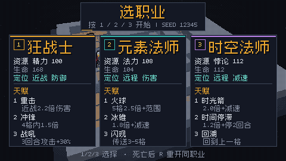

*review3_window_menu.png：`vx.exe --frames 2`，无参数启动即职业菜单；SEED 显示 12345（不是本局真实种子）。*

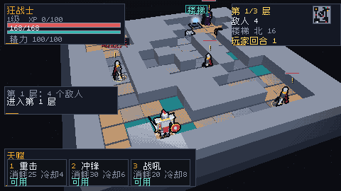

*review3_start.png：第 1 层第 1 回合。左上角色/HP/资源、右上楼层/敌人/楼梯/回合 + 26px 小地图、左中日志、底部天赋栏；没有"当前目标"常驻信息。*

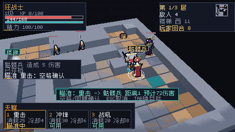

*review3_aim_valid.png：瞄准框青色，"距离1 预计72伤害"，第二行"空格/同键确认 ESC取消 TAB换目标"。*

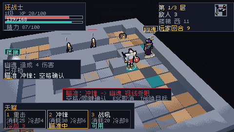

*review3_aim_charge.png：冲锋 3 格、墙挡住视线 → 红字"视线受阻"；空格确认后 0 回合 0 资源。*

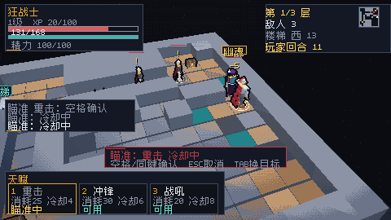

*review3_aim_stuck.png：重击冷却 1 回合，连按 1/空格/5 得到 4 行"瞄准：冷却中"，回合停在 11。*

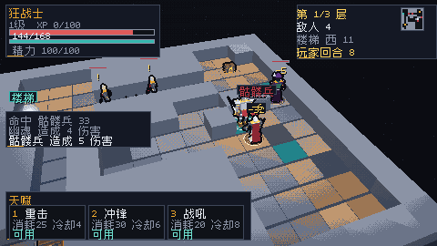

*review3_approach.png：顶部"幽魂"名字牌被屏幕边缘切掉；日志面板 160×40 盖住左侧房间；底部天赋栏显示"冷却 3"。*

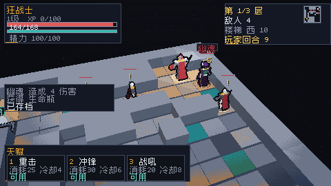

*review3_chest.png：踩上宝箱格即开，"打开宝箱：恢复 18 生命"+"获得 生命瓶"；无 toast，只有日志。*

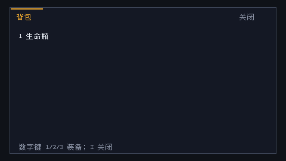

*review3_inventory_empty.png：全屏 448×246；列表只有"1 生命瓶"；按 1 之后的画面与这张完全相同——"不能装备"的日志被面板盖住。*

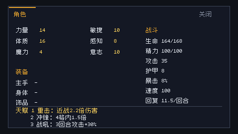

*review3_character.png：没有职业、等级、XP、回合；"速度 100"没有解释。*

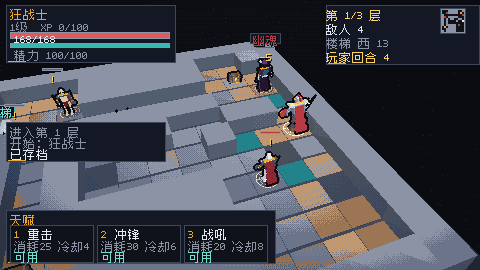

*review3_save.png：日志末行"已存档"，下一回合就会被战斗日志顶掉；没有路径/槽位/时间。*

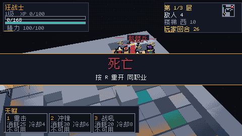

*review3_death.png：HP 0/168，第 1 层第 26 回合；"死亡 / 按 R 重开 同职业"，没有层数/等级/回合/击杀/死因/种子，最后几行战斗日志被结算条压住。*

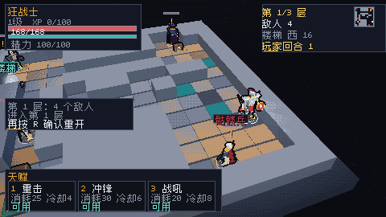

*review3_r_confirm.png：游戏中按一次 R 不会丢局，日志提示"再按 R 确认重开"；死亡态按 R 立即重开。*

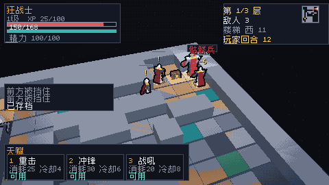

*review3_repeat_burst.png：19 个 repeat 事件在 1 秒内推进 9 个回合并刷出 6 行撞墙日志。*

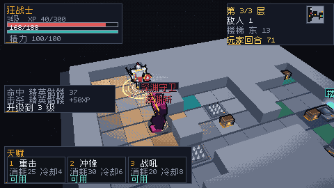

*review3_levelup.png（`--auto --frames 700`）：日志"击杀 精英骷髅 +50XP / 升级到 3 级"；左上"3级 XP 40/300"。*

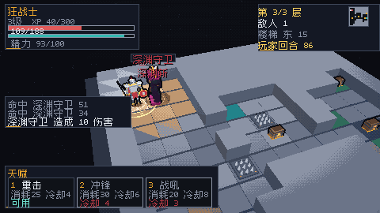

*review3_boss.png（`--auto --frames 850`）：Boss 血条明显更宽；没有任何"×2/封印/倒计时"提示。*

*review3_auto.png（`--auto --frames 5000`）：第 3/3 层第 93 回合胜利；只有"胜利 / 按 R 重开 同职业"。*

其他：[review3_menu.png](screenshots/review3_menu.png)（`--start-menu`）、[review3_aim.png](screenshots/review3_aim.png)（`--aim 0`）、[review3_help.png](screenshots/review3_help.png)（`--help-screen`，与窗口内按 H 一致）。

## 9. 复现

~~~powershell
zig build
zig-out/bin/vx.exe --frames 2 --out docs/screenshots/review3_window_menu.png
zig-out/bin/vx.exe --headless --start-menu --frames 2 --out docs/screenshots/review3_menu.png
zig-out/bin/vx.exe --headless --frames 2 --out docs/screenshots/review3_start.png
zig-out/bin/vx.exe --headless --aim 0 --frames 2 --out docs/screenshots/review3_aim.png
zig-out/bin/vx.exe --headless --help-screen --frames 2 --out docs/screenshots/review3_help.png
zig-out/bin/vx.exe --headless --auto --frames 5000 --out docs/screenshots/review3_auto.png
zig-out/bin/vx.exe --headless --auto --frames 700 --out shots/auto_700.png
zig-out/bin/vx.exe --headless --auto --frames 850 --out shots/auto_850.png
~~~

窗口走查：`vx.exe --run-seconds 1500`，用 `PostMessage(WM_KEYDOWN/WM_KEYUP)` 注入 `1`（选职业）、`W/A/S/D/↑/KP8/KP4`、`1/2/3`、`Tab`、`Space`、`5`、`.`、`I/C/H`、`F5/F9`、`R`、`Esc`、`F12` 截图；每步用 F5 写出 `saves/tome-run.json` 反读状态（提交前已删除）。

## 10. 下一轮不要做什么

- **不要再加一层"按住连走"而不加节流**；先让"一步 = 一次确认"重新成立，再谈手感。
- **不要用"确认失败就再写一行日志"当反馈**；瞄准态必须提供"等待/取消/换目标"三个明确出路。
- **不要在 30.9% 的预算上继续加面板**；先把目标条塞进现有面板（或合并左上/右上），再考虑新信息。
- **不要把"规则已实现"当成"玩家能感知"**：速度、封印、深渊斩都是例子——没有徽章、倒计时、首层 toast，就等于没做。
- **不要让 F9 无确认覆盖当前局**，也不要让菜单显示一个假的 seed。
- **不要在结算页只写两行字**；死因和种子是 roguelike 的核心反馈。

---

*本文不改游戏代码，只新增 `docs/UX_REVIEW_TOME3.md` 与 `docs/screenshots/review3_*.png`。所有结论基于 `feat/tome-critic3` @ `5a4a305` 的构建；`--arena` 旧实时模式不在范围内。*
