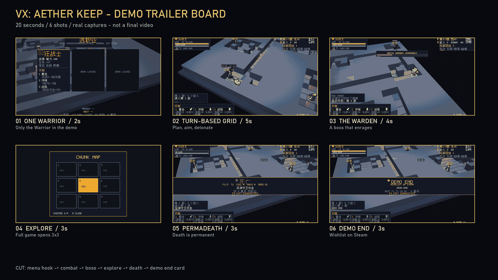

# Demo 预告片分镜（20s）

状态：分镜板与真实截图已就绪；**没有编码视频/音频**。

## 镜头

| # | 时间 | 画面 | 字幕 |
| --- | --- | --- | --- |
| 1 | 0–2s | Demo 菜单，2/3 LOCKED | ONE WARRIOR |
| 2 | 2–7s | 战斗/炸弹/瞄准 | TURN-BASED GRID |
| 3 | 7–11s | Boss 血条 ENRAGED | THE WARDEN |
| 4 | 11–14s | 3×3 地图（完整版） | EXPLORE |
| 5 | 14–17s | 死亡结算 | PERMADEATH |
| 6 | 17–20s | DEMO END | WISHLIST ON STEAM |

## 剪辑

- 2 秒菜单钩子
- 战斗用真实回合计时，不加速到看不懂
- Boss 镜头保留 ENRAGED 标签
- 结尾 3 秒留白给 Wishlist
- 不做虚假“媒体评价”

## 音频

- 现有程序化 SFX 可做底
- 需要一段 20s 氛围/打击乐；未作曲
- 不直接使用未授权音乐

## 输出

- 16:9 1920×1080
- 30/60fps
- H.264 MP4，<100 MB
- 另出 9:16 竖版 15s（待做）

本文件不是“预告片已完成”的声明。
